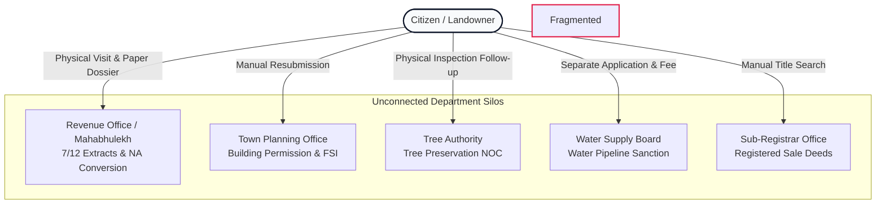
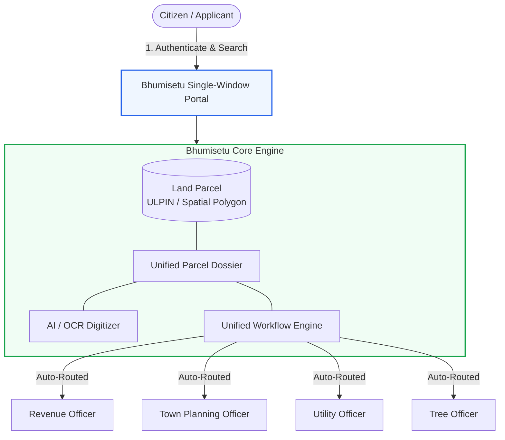

# 01. Project Overview — Bhumisetu (भूमिसेतू)

> **Academic Year:** 2026–27  
> **Project Title:** Bhumisetu: AI-Enabled, GIS-Based Integrated Land Information & Single-Window Land Service Platform  
> **Tagline:** *"One Parcel. One Window."*  

---

## What This Document Covers

This document provides a foundational introduction to the Bhumisetu project for academic evaluators, project guides, and viva examiners. It outlines the systemic challenges in India's fragmented land governance systems, specifies the core objectives and scope of the prototype, identifies primary user cohorts, and presents a structured comparison highlighting how Bhumisetu advances beyond conventional land-record portals. Finally, it provides a plain-language, two-minute viva summary that a student can present during evaluation.

---

## 1. Background: The Problem of Fragmented Land Administration in India

Land administration in India has traditionally operated in strict departmental silos. While several states have digitized their text-based Records of Rights (RoR)—such as Maharashtra’s *Mahabhulekh*, Karnataka’s *Bhoomi*, or Gujarat’s *AnyRoR*—these portals remain isolated record-viewers rather than integrated transaction platforms.

In real-world citizen journeys, owning and developing land requires interaction with multiple disjointed authorities:

1. **Revenue Department (Tahsildar / Talathi):** Maintains textual 7/12 (Satbara) extracts, 8-A mutation registers, and grants Non-Agricultural (NA) conversion permissions.
2. **Survey & Settlement Department:** Maintains spatial cadastral maps (*Cadastral maps* are comprehensive land survey maps displaying parcel boundaries, lengths, and ownership lines) and assigns village survey numbers.
3. **Town Planning & Municipal Corporations (e.g., PMC, PCMC, BBMP):** Enforces building bylaws, calculates Floor Space Index (FSI), and issues Sanctioned Building Permissions and Commencement Certificates.
4. **Registration & Stamps Department (Sub-Registrar):** Registers Deeds of Conveyance (Sale Deeds) and issues Encumbrance Certificates (*Encumbrance Certificate* is a legal record certifying whether a property has registered financial liabilities or legal disputes).
5. **Urban Forestry / Tree Authority:** Inspects tree canopy cover and issues felling or preservation No-Objection Certificates (NOCs).
6. **Public Utility Boards:** Issues sanctions for municipal drinking water pipelines, sewage lines, and electrical grid access.

### Key Pain Points in the Existing Ecosystem

* **Physical Paper Churn:** A citizen seeking to construct a home or commercial building must photocopy 7/12 extracts, title deeds, and blueprints, physically traveling between multiple government offices.
* **Cadastral vs. Registry Discrepancy:** The textual area in the 7/12 extract often differs from the physical spatial polygon on the ground due to historical unmapped sub-divisions.
* **Information Asymmetry & Duplicate Scrutiny:** Town planning engineers must independently verify whether a land parcel has clear title or pending revenue encumbrances, leading to redundant scrutiny and months of delays.
* **Lack of Spatial Transparency:** Ordinary portals display alphanumeric survey numbers with no interactive geospatial map layer showing zoning, environmental overlays, or surrounding infrastructure.

---

## 2. Core Concepts & Definitions

To understand Bhumisetu, the following foundational concepts must be understood:

* **ULPIN (Unique Land Parcel Identification Number):** Often termed the *"Aadhaar for Land"*, ULPIN is a government-mandated standard 14-character alphanumeric identifier derived from the geographic coordinates (latitude and longitude) of a parcel's centroid and boundary vertices. In Bhumisetu, every parcel is anchored to a unique ULPIN (e.g., `MH-PUN-HIN-001`).
* **GIS (Geographic Information System):** A computer-based framework for capturing, managing, analyzing, and displaying spatial or geographic data.
* **PostGIS:** An open-source spatial database extender for the PostgreSQL relational database. It adds support for geographic objects, allowing spatial queries such as determining whether a point falls inside a parcel polygon (`ST_Contains`) or finding parcels within a GPS bounding box.
* **GeoJSON:** An open standard format based on JSON (JavaScript Object Notation) designed for encoding geographical data structures, such as parcel boundary polygons and feature properties.
* **OCR (Optical Character Recognition):** Software technology that converts typed, scanned, or photographed text from document images into machine-readable and editable text data.
* **JWT (JSON Web Token):** A compact, URL-safe means of representing claims to be transferred between two parties, used in Bhumisetu for stateless, cryptographically signed API authentication.
* **RBAC (Role-Based Access Control):** A security mechanism where system access and execution permissions are granted based on assigned organizational roles (e.g., Citizen, Planning Officer, Revenue Officer, Admin).

---

## 3. The Bhumisetu Solution: "One Parcel. One Window."

**Bhumisetu** (meaning *Bridge to Land Services*) re-architects government-to-citizen (G2C) land administration from a **department-centric** model to a **parcel-centric** model.

Instead of making the citizen navigate five departments, Bhumisetu organizes all municipal and revenue data around the **Land Parcel**. Everything—ownership history, scanned title deeds, non-agricultural status, utility sanctions, and pending municipal applications—hangs off a single spatial parcel record.

---

## 4. Objectives of the Project

1. **Establish a Parcel-Centric Land Record Model:** Unify fragmented revenue records, cadastral GIS polygons, ownership deeds, and departmental histories under a single canonical entity identified by ULPIN.
2. **Provide an Interactive GIS Cadastral Viewer:** Enable citizens and government officials to view parcel polygons, color-coded by land use (Residential, Commercial, Agricultural, Industrial, Public Utility), overlaid on live OpenStreetMap tiles using Leaflet and PostGIS.
3. **Automate Document Ingestion using AI / OCR:** Enable instant scanning of Marathi and English land records (such as 7/12 Satbara extracts and registered sale deeds) using Tesseract OCR, automated regex extraction, and fuzzy cadastral cross-referencing.
4. **Implement an Automated Single-Window Workflow Engine:** Provide an end-to-end digital application lifecycle for Building Permissions, Land-Use (NA) Conversions, and Water Connections, automatically routing requests to designated municipal officers based on departmental jurisdiction.
5. **Enforce Role-Based Access Control & Immutable Auditing:** Ensure strict separation of duties between citizens and government officers via Spring Security and JWT, while logging every state transition, query, and administrative decision into an immutable audit trail.

---

## 5. Scope of the Academic Prototype

### In-Scope (Implemented & Demonstrated)
* Full-stack working prototype covering Pune municipal and peri-urban parcels (e.g., Hinjewadi, Wakad, Baner, Kothrud, Shivajinagar, Hadapsar).
* Spatial PostgreSQL/PostGIS database storing 25 realistic cadastral parcels with exact Polygon WKT boundaries (SRID 4326).
* Full REST API backend built in Spring Boot 3 with Spring Data JPA and Hibernate Spatial.
* Modern Single-Page Application (SPA) frontend built in React 19, Vite, and Tailwind CSS.
* Interactive Leaflet web map supporting polygon click-to-dossier, bounding box queries, and cadastral zoom controls.
* AI Document Digitizer powered by Tess4J (Tesseract 5 OCR) with a robust heuristic regex parser extracting ULPIN, survey numbers, village names, areas, and owner details, supported by an intelligent simulated fallback.
* Smart Cadastral & Document Full-Text Search with hit highlighting.
* Multi-department officer queue, workflow decision panel (Approve / Reject / Request Information), and applicant tracking timeline.
* Administrative analytics dashboard displaying municipal throughput, SLA statistics, service distributions, and system audit logs.

### Out-of-Scope (Documented as Future Scope)
* Direct network integration with production state revenue servers (e.g., live Mahabhulekh NIC API, which requires government VPN credentials).
* Legal digital signatures via eMudhra / Aadhaar eSign (simulated via authenticated cryptographic audit logs in the prototype).
* Financial payment gateway integration (mocked submission fee status).
* Vector-database powered semantic search using text embedding models (e.g., pgvector / OpenAI embeddings).

---

## 6. Target User Personas

| Role Name | System Role Code | Primary Objectives & Tasks |
| :--- | :--- | :--- |
| **Citizen / Landowner** | `ROLE_CITIZEN` | Searches parcels on map or via survey number; views public land dossier; uploads scanned deeds to extract data; submits applications (Building Permission, NA Conversion, Water Connection); tracks workflow status in real time. |
| **Revenue Officer / Tahsildar** | `ROLE_REVENUE_OFFICER` | Scrutinizes land-use conversion (NA) applications; verifies 7/12 extracts and ownership legitimacy; approves or rejects agricultural-to-non-agricultural zoning changes. |
| **Town Planning Officer** | `ROLE_PLANNING_OFFICER` | Reviews architectural proposals, FSI compliance, and sanctioned building permissions; inspects spatial boundaries against municipal master plans. |
| **Tree Authority Officer** | `ROLE_TREE_OFFICER` | Assesses green cover and tree preservation compliance; reviews felling/transplantation NOC requests linked to building sanctions. |
| **Utility Engineer** | `ROLE_UTILITY_OFFICER` | Inspects water pipeline feasibility, drainage layouts, and municipal sewer connectivity; sanctions water connection requests. |
| **System Administrator** | `ROLE_ADMIN` | Oversees platform health, inspects immutable system audit logs, monitors departmental throughput analytics, and manages municipal user directories. |

---

## 7. Comparative Analysis: Ordinary Portals vs. Bhumisetu

| Dimension | Ordinary State Land Portal (e.g., Mahabhulekh) | Municipal Town Planning Portal | Bhumisetu Single-Window Platform |
| :--- | :--- | :--- | :--- |
| **Architectural Model** | Department-centric (Revenue only) | Department-centric (Municipal only) | **Parcel-Centric (Integrated Single-Window)** |
| **Spatial Cadastral Map** | None or static PDF maps (*Village Nakasha*) | Separate GIS viewer without title data | **Interactive Leaflet/PostGIS layer linked directly to legal records** |
| **Identifier Standard** | Arbitrary village survey/gat numbers | Municipal property tax assessment number | **Standardized 14-character ULPIN with geographic coordinates** |
| **Document Processing** | Citizen manually uploads PDF; manual entry | Citizen submits paper prints | **AI-driven OCR & regex metadata extraction with auto-verification** |
| **Service Workflow** | Read-only; cannot apply for permissions | Separate login; must re-verify ownership | **Unified workflow: apply, route, scrutinize, and track in one place** |
| **Inter-Department Visibility** | Zero visibility into municipal permits | Zero visibility into pending revenue disputes | **Single Dossier displays ownership, permits, and history simultaneously** |
| **Search Capabilities** | Strict exact match on district/taluka/village | Strict application number lookup | **Unified Smart Search across spatial bbox, ULPIN, survey no, and full-text OCR** |
| **Auditing & Transparency** | Internal department logs | Departmental physical registers | **Immutable audit trail capturing all user actions, IP addresses, and decisions** |

---

## 8. Explain Bhumisetu in 2 Minutes (Viva Pitch)

> *"Good morning, Respected Guide and Examiners. Today, I am presenting **Bhumisetu**, an AI-enabled, GIS-based integrated land information and single-window service platform.*
>
> *In India today, land services are heavily fragmented. If a citizen wants to build a house or develop a plot, they must navigate multiple disjointed offices: the Revenue Department for 7/12 records and NA conversion, the Municipal Corporation for building plans, and utility boards for water pipelines. Each department operates in isolation, requiring paper copies and manual title re-verification, causing delays, corruption, and title disputes.*
>
> *Bhumisetu solves this by shifting from a **department-centric** model to a **parcel-centric** model under the principle: **'One Parcel. One Window.'** Every piece of land is anchored to its standardized 14-character **ULPIN** (Unique Land Parcel Identification Number) and its exact geospatial boundary stored in a **PostGIS** spatial database.*
>
> *On the frontend, built with React and Leaflet, citizens can interactively click any plot on a live map to view its comprehensive **Parcel Dossier**—showing ownership, zoning, approved permits, and scanned documents. When a citizen uploads an old scanned 7/12 extract or deed, our integrated **AI OCR engine** extracts the survey number, ULPIN, area, and owners automatically, linking it directly to the cadastral map.*
>
> *Furthermore, citizens can apply for building permissions or utility connections through an integrated wizard. The system automatically routes the application to the respective Town Planning, Revenue, or Utility officer queue. The officer inspects the digital dossier and approves or rejects it with feedback, which the citizen can track in real time. Every action is secured using **JWT-based Role-Based Access Control** and logged in an immutable audit trail.*
>
> *In short, Bhumisetu turns weeks of bureaucratic paper chasing into a transparent, instant, single-window digital experience."*

---

## Key Takeaways

1. **Parcel-Centric Paradigm:** Bhumisetu organizes all land information (revenue, legal, municipal, and utility) around the geographic land parcel rather than disparate government departments.
2. **Geospatial Core:** Built on PostgreSQL with PostGIS extensions, the platform treats land boundaries as first-class geometric polygons represented in WGS-84 (SRID 4326) and served via GeoJSON.
3. **AI-Assisted Digitization:** Scanned paper documents (such as 7/12 Satbara extracts) are digitized using Tesseract OCR and automated regex rules to extract cadastral metadata and link them to parcels.
4. **Single-Window G2C Workflow:** Provides an end-to-end service delivery pipeline where applications are automatically routed to municipal officers with strict role separation and end-to-end tracking.
5. **Academic & Production Ready:** The prototype runs end-to-end with 25 realistic cadastral parcels, 6 distinct user roles, and full test data matching the Pune municipal region.
