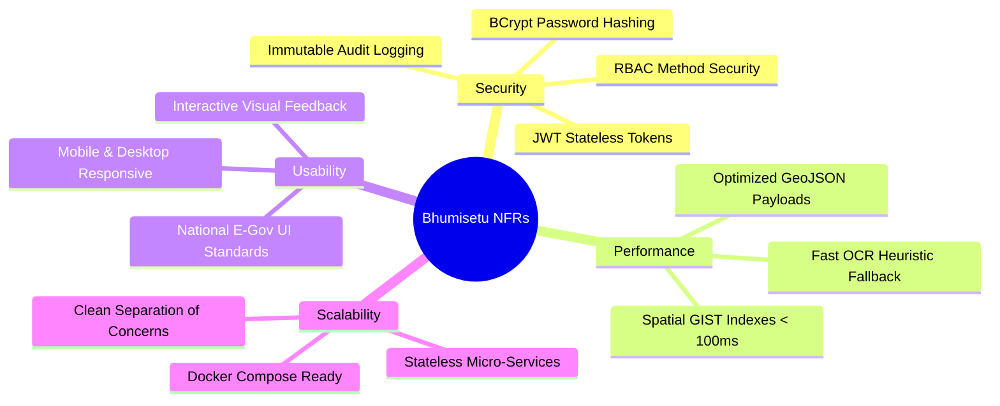
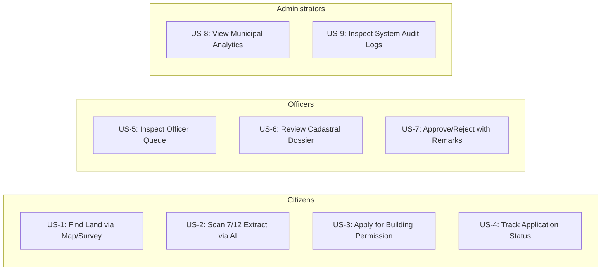

# 02. Requirements Specification — Bhumisetu (भूमिसेतू)

> **Academic Year:** 2026–27  
> **Project Title:** Bhumisetu: AI-Enabled, GIS-Based Integrated Land Information & Single-Window Land Service Platform  
> **Tagline:** *"One Parcel. One Window."*  

---

## What This Document Covers

This document details the complete requirements specification for the Bhumisetu platform. It enumerates all Functional Requirements (FR) categorized by subsystem, outlines Non-Functional Requirements (NFR) spanning security, performance, usability, and scalability, presents user stories for every system persona, and establishes a clear boundary between the implemented Minimum Viable Product (MVP) and out-of-scope enhancements.

---

## 1. Functional Requirements (FR)

### 1.1 Authentication & User Management (AUTH)
* **FR-1 [User Registration]:** The system shall allow citizens to create accounts by providing their full name, valid email address, phone number, and a secure password.
* **FR-2 [JWT Authentication]:** The system shall authenticate users via email and password, issuing a signed JSON Web Token (JWT) with a configured time-to-live (24 hours).
* **FR-3 [Role Assignment]:** The system shall assign an immutable system role (`CITIZEN`, `REVENUE_OFFICER`, `PLANNING_OFFICER`, `TREE_OFFICER`, `UTILITY_OFFICER`, `ADMIN`) to every registered user upon creation or initialization.
* **FR-4 [Profile Retrieval]:** The system shall provide an authenticated `/api/auth/me` endpoint to retrieve the currently active user profile and authorization scopes.

### 1.2 GIS Cadastral Mapping & Spatial Operations (GIS)
* **FR-5 [Cadastral Polygon Storage]:** The system shall store land parcels as high-precision 2D polygon geometries in PostGIS using the WGS-84 coordinate reference system (SRID 4326).
* **FR-6 [GeoJSON Feature Collection]:** The system shall provide an endpoint `/api/parcels/geojson` that serves all cadastral parcels formatted as a standard GeoJSON FeatureCollection with attributes (ULPIN, survey number, land use, area, village).
* **FR-7 [Interactive Map Rendering]:** The web application shall render parcel boundary polygons on a Leaflet map, visually color-coded according to approved Land Use types (`RESIDENTIAL`, `COMMERCIAL`, `AGRICULTURAL`, `INDUSTRIAL`, `PUBLIC_UTILITY`, `MIXED_USE`).
* **FR-8 [Spatial Point-in-Polygon Query]:** The system shall identify and return the specific land parcel polygon containing any geographic point clicked by a user on the map (`/api/parcels/spatial/point?lat=...&lon=...`).
* **FR-9 [Spatial Bounding Box Query]:** The system shall return all parcels whose geometry intersects a given viewport bounding box (`/api/parcels/spatial/bbox?minLon=...&minLat=...&maxLon=...&maxLat=...`).

### 1.3 AI Document Digitization & OCR (AI)
* **FR-10 [Document File Upload]:** The system shall allow authorized users to upload scanned land records (such as 7/12 extracts, sale deeds, building plans) in PDF, PNG, or JPEG formats up to 20MB in size.
* **FR-11 [OCR Text Extraction]:** The system shall execute optical character recognition via Tess4J (Tesseract OCR Engine) to extract plain text from uploaded document scans, gracefully falling back to a deterministic heuristic extractor if local OCR binaries are unavailable.
* **FR-12 [Cadastral Metadata Parser]:** The system shall analyze extracted text using regular expressions to extract key cadastral entities: Document Type, Survey/Gat Number, ULPIN, Village Name, Area (Sq. Meters), Registration Number, and Owner Names.
* **FR-13 [Verification & Parcel Linking]:** The system shall present extracted fields with calculated confidence scores, allowing the user or officer to verify/edit values before permanently attaching the document to the corresponding land parcel record.

### 1.4 Single-Window Service Applications (APP)
* **FR-14 [Single-Window Application Submission]:** The system shall provide a multi-step submission wizard enabling citizens to apply for:
  1. *Building Permission*
  2. *Land-Use Change (NA Conversion)*
  3. *Water & Sewerage Connection*
* **FR-15 [Parcel Association]:** Every submitted application must reference a valid land parcel ID and associate supporting uploaded documents.
* **FR-16 [Automated Application Number Generation]:** The system shall generate a unique, human-readable application reference code formatted as `BS-YYYY-[SERVICE_CODE]-[SEQUENCE]` (e.g., `BS-2026-BP-00101`).
* **FR-17 [Citizen Application Tracking]:** Citizens shall be able to list all their submitted applications (`/api/applications/my`) and inspect full application status, remarks, and historical timeline events.

### 1.5 Departmental Workflow Engine & Decisioning (WF)
* **FR-18 [Automated Departmental Routing]:** When an application is created, the system shall automatically route it to the responsible department based on the service type:
  * *Building Permission* $\rightarrow$ Town Planning Department (`PLANNING_OFFICER`)
  * *Land-Use Change (NA)* $\rightarrow$ Revenue & Land Records Department (`REVENUE_OFFICER`)
  * *Water Connection* $\rightarrow$ Water Supply & Utilities Department (`UTILITY_OFFICER`)
* **FR-19 [Officer Queue Filtering]:** Department officers shall access a dedicated queue (`/api/applications/officer/queue`) displaying only applications assigned to their respective departmental jurisdiction.
* **FR-20 [Workflow Decision Action]:** Officers shall have the authority to transition applications through state changes:
  * `UNDER_REVIEW`: Officer begins formal scrutiny.
  * `INFO_REQUESTED`: Officer requests additional clarifications or missing documents from the applicant.
  * `APPROVED`: Officer grants formal sanction.
  * `REJECTED`: Officer denies the application with mandatory explanatory remarks.
* **FR-21 [Workflow History Recording]:** Every decision step must record an immutable `WorkflowHistory` entry detailing previous status, new status, officer ID, remarks, and an exact timestamp.

### 1.6 Cadastral Dossier & Smart Search (SRCH)
* **FR-22 [Unified Parcel Dossier]:** The system shall aggregate and return a comprehensive 360-degree dossier for any parcel (`/api/parcels/{id}/dossier` or `/api/parcels/by-ulpin/{ulpin}/dossier`), combining spatial attributes, current ownerships, verified documents, active applications, and complete historical audit records.
* **FR-23 [Smart Cadastral Search]:** The system shall provide unified search (`/api/parcels?q=...`) matching across Survey Numbers, ULPINs, and Village names.
* **FR-24 [Full-Text Document Search]:** The system shall search across OCR-digitized document text and metadata (`/api/documents/search?q=...`) returning highlighted textual snippets and matched document types.

### 1.7 Administration & Audit Logging (ADM)
* **FR-25 [System Analytics]:** The system shall provide an administrative analytics endpoint (`/api/admin/analytics`) aggregating total parcels, applications by status, department throughput, and average processing times.
* **FR-26 [User Directory Management]:** Administrators shall be able to view all registered users and their associated departmental credentials (`/api/admin/users`).
* **FR-27 [Immutable Audit Trail]:** The system shall intercept and record critical system events into an immutable `AuditLog` table capturing user ID, email, action name, target entity, entity ID, client IP address, details, and timestamp.

---

## 2. Non-Functional Requirements (NFR)

### 2.1 Security Requirements (NFR-SEC)
* **NFR-SEC-1 [Stateless Authentication]:** All API interactions (excluding public endpoints) must be authenticated using stateless JWT Bearer tokens passed via the standard HTTP `Authorization` header.
* **NFR-SEC-2 [Cryptographic Password Storage]:** All user passwords must be hashed using the BCrypt algorithm with a work factor of 10 or higher. Plaintext passwords must never be stored, logged, or returned in any API response.
* **NFR-SEC-3 [Role-Based Access Enforcement]:** Strict Role-Based Access Control (RBAC) must be enforced at both the HTTP security filter layer (`SecurityFilterChain`) and the Java method execution layer (`@PreAuthorize`). Citizens must be strictly forbidden from executing officer decisions (`HTTP 403 Forbidden`).
* **NFR-SEC-4 [Injection & Payload Protection]:** All database access must use parameterized JPA queries to prevent SQL injection. File uploads must be constrained to safe MIME types and stored outside the public execution path.

### 2.2 Performance Requirements (NFR-PERF)
* **NFR-PERF-1 [Spatial Query Response Time]:** Spatial queries (`ST_Contains`, `ST_Intersects`, bounding box lookups) over the indexed cadastral dataset must execute in under 100ms on standard hardware.
* **NFR-PERF-2 [GeoJSON Payload Size]:** The full GeoJSON payload representing all municipal parcels must be optimized (under 250 KB) to ensure rapid initial rendering on client browsers.
* **NFR-PERF-3 [OCR Throughput]:** Document OCR processing and metadata extraction must complete within 3 seconds for standard single-page document images.
* **NFR-PERF-4 [Client-Side Bundle Efficiency]:** The frontend SPA bundle built via Vite must achieve sub-second load times on modern broadband connections.

### 2.3 Usability Requirements (NFR-USA)
* **NFR-USA-1 [Government UI Standard]:** The user interface must adopt clean, high-contrast, professional government portal aesthetics (Navy Blue `#0B2545`, Gold `#DDA15E`, Forest Green `#137547`) using clear typography (Inter / System Sans).
* **NFR-USA-2 [Responsive Design]:** All pages, including the GIS map viewer, dossier panels, and application tracking timelines, must adapt responsively to desktop and tablet viewports.
* **NFR-USA-3 [Actionable Feedback]:** All asynchronous operations (saving decisions, uploading documents, running OCR) must provide clear visual feedback, including progress indicators, toast alerts, and status badges.

### 2.4 Scalability & Portability (NFR-SCA)
* **NFR-SCA-1 [Containerized Portability]:** The entire system stack (database, backend, frontend) must be fully deployable on any modern Linux or Windows machine with a single `docker-compose up` command.
* **NFR-SCA-2 [Stateless Application Tier]:** The Spring Boot backend service must remain completely stateless, allowing horizontal scaling across multiple container instances behind a reverse proxy.
* **NFR-SCA-3 [Database Flexibility]:** The system must support development execution using in-memory H2 with H2GIS spatial extensions, as well as production enterprise deployment using PostgreSQL 16 with PostGIS 3.4.

---

## 3. User Stories by Persona

### 3.1 Citizen User Stories
* **US-1 [Map-Based Parcel Discovery]:** *As a Citizen/Buyer,* I want to search for a land parcel by Survey Number or click directly on an interactive map, so that I can verify its exact boundary, official area, and approved land use before purchasing.
* **US-2 [Instant Scanned Extract Parsing]:** *As a Citizen/Landowner,* I want to upload a photograph of an old 7/12 Satbara extract, so that the system automatically extracts the survey number, area, and owner names without manual typing.
* **US-3 [Single-Window Service Application]:** *As a Citizen,* I want to apply for a Sanctioned Building Permission online by selecting my parcel and uploading documents, so that I do not need to physically visit the municipal town planning desk.
* **US-4 [Transparent Application Tracking]:** *As a Citizen,* I want to enter my application tracking number (`BS-2026-BP-00101`) to see which officer is reviewing my file and inspect every decision remark in chronological order.

### 3.2 Department Officer User Stories
* **US-5 [Dedicated Review Queue]:** *As a Town Planning Officer,* I want to log into my dashboard and view a filtered queue containing only pending Building Permission applications, so that I can prioritize my daily municipal casework.
* **US-6 [Cross-Departmental Dossier Verification]:** *As a Revenue Officer,* I want to view the unified Parcel Dossier while evaluating a Land-Use Conversion request, so that I can confirm there are no conflicting ownership claims or unauthorized construction activities.
* **US-7 [Formal Decisioning & Remarks]:** *As an Officer,* I want to record my official decision (`APPROVED`, `REJECTED`, or `INFO_REQUESTED`) with explanatory remarks, so that the applicant receives immediate legal clarity and the decision is permanently recorded in the audit trail.

### 3.3 System Administrator User Stories
* **US-8 [Executive Municipal Analytics]:** *As a Municipal Administrator,* I want to view high-level analytics on total applications submitted, department processing velocity, and approval ratios, so that I can identify departmental bottlenecks.
* **US-9 [Compliance Audit Trail Inspection]:** *As a System Administrator,* I want to query immutable audit logs showing which officer approved an application, from which IP address, and at what timestamp, so that administrative integrity and anti-corruption compliance are ensured.

---

## 4. Minimum Viable Product (MVP) vs. Out-of-Scope Roadmap

| Feature / Capability | Implemented in MVP | Out-of-Scope (Future Scope) | Rationale & Status |
| :--- | :---: | :---: | :--- |
| **Cadastral Spatial Polygons (PostGIS)** | ✅ | — | 25 realistic parcels in Pune (Hinjewadi, Wakad, Baner) seeded with SRID 4326. |
| **Interactive Leaflet Web Map** | ✅ | — | Interactive click-to-select, land-use color coding, and zoom to bounds. |
| **AI OCR & Heuristic Parser** | ✅ | — | Tess4J Tesseract 5 OCR with regex extraction and mock fallback. |
| **Single-Window Workflow Engine** | ✅ | — | Automated routing across Planning, Revenue, and Utility departments. |
| **Officer Decision Workflows** | ✅ | — | Approve, Reject, Info Requested with mandatory remarks and timeline recording. |
| **Role-Based Access Control (RBAC)** | ✅ | — | Strict role enforcement across 6 roles using Spring Security 6 & JWT. |
| **Immutable System Audit Logs** | ✅ | — | Auto-capturing user ID, action, IP address, and entity timestamps. |
| **Smart Full-Text Document Search** | ✅ | — | Full-text query across OCR text and cadastral attributes with snippet highlighting. |
| **Live State Revenue Gateway (Bhulekh API)** | — | 🔮 | Requires official state government credentials, VPN tunnel, and digital tokens. |
| **eMudhra / Aadhaar eSign Legal Verification** | — | 🔮 | Legal electronic signature requiring licensed Certifying Authority (CA) gateway. |
| **Online Payment Gateway (UPI / Razorpay)** | — | 🔮 | Commercial merchant accounts and compliance required for real financial transactions. |
| **Vector Embeddings Semantic Search** | — | 🔮 | Requires OpenAI/HuggingFace embedding pipelines and `pgvector` extension. |
| **Multilingual Devanagari UI** | — | 🔮 | Complete Hindi and Marathi localized frontend UI bundle. |

---

## Key Takeaways

1. **27 Numbered Functional Requirements:** Covers user authentication, PostGIS spatial queries, OCR extraction, single-window workflow routing, smart search, and administrative audit logging.
2. **Enterprise Non-Functional Standards:** Mandates stateless JWT security, BCrypt hashing, sub-100ms spatial response times, and standard e-governance visual aesthetics.
3. **Multi-Persona User Stories:** Explicitly models requirements for Citizens, Revenue Officers, Planning Officers, Tree Officers, Utility Engineers, and System Administrators.
4. **Clear Academic MVP Boundary:** All core single-window capabilities are fully implemented in code; external government dependencies (e-Sign, live state VPN APIs, payment gateways) are explicitly demarcated as Future Scope.
