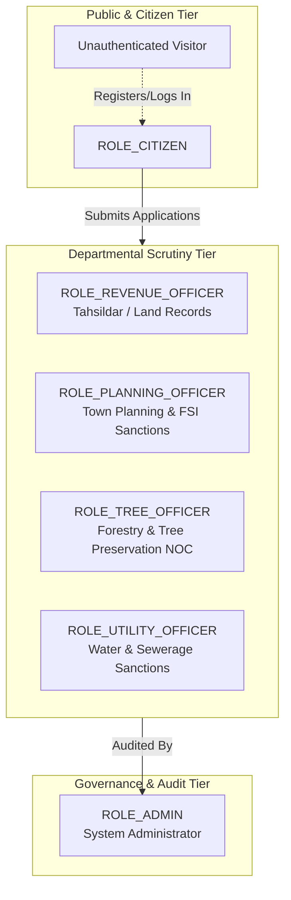
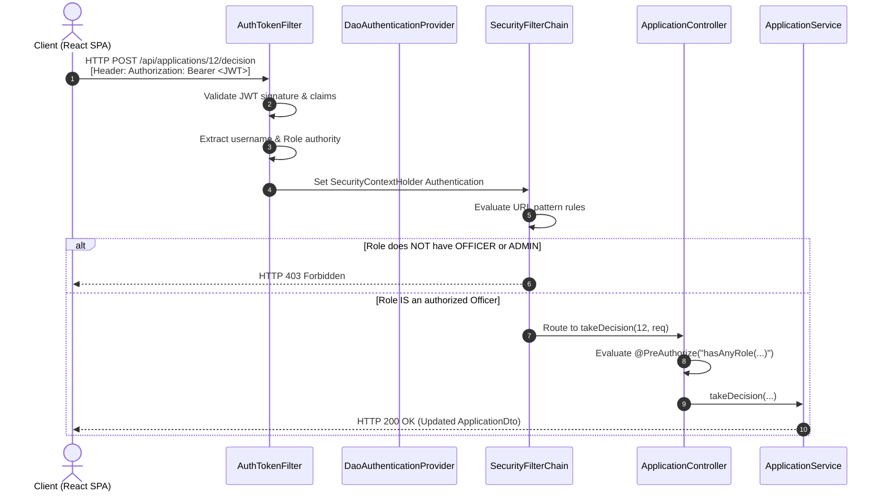

# 03. User Roles & Role-Based Access Control (RBAC) — Bhumisetu (भूमिसेतू)

> **Academic Year:** 2026–27  
> **Project Title:** Bhumisetu: AI-Enabled, GIS-Based Integrated Land Information & Single-Window Land Service Platform  
> **Tagline:** *"One Parcel. One Window."*  

---

## What This Document Covers

This document details the Role-Based Access Control (RBAC) architecture of Bhumisetu. It explains how technical permissions and operational separation of duties are established across all six user roles. It provides a complete Feature-to-Role Permission Matrix and shows exactly how these access controls are enforced at both the backend (Spring Security 6, JWT, and Method Security) and frontend (React Protected Routes and Conditional Rendering) layers, citing the exact source files and classes in the codebase.

---

## 1. Role Definitions & Responsibilities

Bhumisetu defines six distinct roles represented by the Java enumeration `in.bhumisetu.domain.enums.Role`:



### 1. `ROLE_CITIZEN` (Citizen / Landowner / Developer)
* **Description:** Represents regular citizens, prospective property buyers, developers, or architects.
* **Responsibilities:**
  * Search and inspect any land parcel polygon and view public cadastral records.
  * Upload scanned title deeds or 7/12 extracts to digitize via OCR.
  * Submit single-window applications for Building Permission, NA Conversion, or Water Connection.
  * Track personal application statuses and review officer remarks.
  * View their own submitted applications and personal profile.
* **Key Restriction:** Citizens are strictly prohibited from viewing officer internal queues or taking workflow approval/rejection decisions.

### 2. `ROLE_REVENUE_OFFICER` (Tahsildar / Land Records Officer)
* **Department:** `REVENUE` (Revenue & Land Records Department).
* **Responsibilities:**
  * Access the Revenue Officer review queue.
  * Scrutinize Land-Use Change (NA Conversion) applications.
  * Verify 7/12 extracts, mutation history, and ownership records.
  * Issue official workflow decisions (`APPROVED`, `REJECTED`, or `INFO_REQUESTED`) with legally binding remarks.

### 3. `ROLE_PLANNING_OFFICER` (Town Planner / Municipal Engineer)
* **Department:** `PLANNING` (Town Planning & Municipal Sanctions Department).
* **Responsibilities:**
  * Access the Planning Officer review queue.
  * Review Sanctioned Building Permission applications.
  * Evaluate compliance with municipal master plans, zoning regulations, and Floor Space Index (FSI).
  * Approve, reject, or request revised architectural drawings.

### 4. `ROLE_TREE_OFFICER` (Urban Forestry Officer)
* **Department:** `TREE` (Urban Forestry & Tree Authority).
* **Responsibilities:**
  * Review tree preservation compliance and tree felling NOC requests.
  * Inspect site environmental overlays on the GIS cadastral map before municipal clearances are granted.

### 5. `ROLE_UTILITY_OFFICER` (Executive Engineer - Utilities)
* **Department:** `UTILITY` (Water Supply & Public Utilities Department).
* **Responsibilities:**
  * Access the Utility review queue.
  * Evaluate Water & Sewerage Connection applications against municipal pipeline networks.
  * Issue sanctions for water line tapping and drainage connectivity.

### 6. `ROLE_ADMIN` (Municipal System Administrator)
* **Department:** Cross-departmental administrative authority.
* **Responsibilities:**
  * Monitor platform operations and system health.
  * Access executive municipal analytics and departmental throughput metrics.
  * View the complete directory of registered citizen and officer accounts.
  * Inspect the immutable, system-wide `AuditLog` trail.
  * Act as a super-officer with emergency override capabilities across all workflow queues.

---

## 2. Comprehensive RBAC Permission Matrix

The following matrix maps every system capability to the authorization status of each role:

| Feature / Operation | Anonymous | `CITIZEN` | `REVENUE_OFFICER` | `PLANNING_OFFICER` | `TREE_OFFICER` | `UTILITY_OFFICER` | `ADMIN` |
| :--- | :---: | :---: | :---: | :---: | :---: | :---: | :---: |
| **View Cadastral Map (GeoJSON)** | ✅ | ✅ | ✅ | ✅ | ✅ | ✅ | ✅ |
| **Search Parcels (Survey No / ULPIN)** | ✅ | ✅ | ✅ | ✅ | ✅ | ✅ | ✅ |
| **View Parcel Dossier Details** | ✅ | ✅ | ✅ | ✅ | ✅ | ✅ | ✅ |
| **Track Application by Number** | ✅ | ✅ | ✅ | ✅ | ✅ | ✅ | ✅ |
| **Upload Scanned Document for OCR** | ❌ | ✅ | ✅ | ✅ | ✅ | ✅ | ✅ |
| **Verify / Save OCR Extracted Metadata** | ❌ | ✅ | ✅ | ✅ | ✅ | ✅ | ✅ |
| **Submit Land Service Application** | ❌ | ✅ | ❌ | ❌ | ❌ | ❌ | ✅ |
| **View Own Submitted Applications** | ❌ | ✅ | ❌ | ❌ | ❌ | ❌ | ✅ |
| **Access Revenue Officer Queue** | ❌ | ❌ | ✅ | ❌ | ❌ | ❌ | ✅ |
| **Access Planning Officer Queue** | ❌ | ❌ | ❌ | ✅ | ❌ | ❌ | ✅ |
| **Access Tree Officer Queue** | ❌ | ❌ | ❌ | ❌ | ✅ | ❌ | ✅ |
| **Access Utility Officer Queue** | ❌ | ❌ | ❌ | ❌ | ❌ | ✅ | ✅ |
| **Execute Workflow Decision (Approve/Reject)** | ❌ | ❌ | ✅ *(Revenue)* | ✅ *(Planning)* | ✅ *(Tree)* | ✅ *(Utility)* | ✅ *(All)* |
| **View Executive Analytics & Charts** | ❌ | ❌ | ❌ | ❌ | ❌ | ❌ | ✅ |
| **View Registered User Directory** | ❌ | ❌ | ❌ | ❌ | ❌ | ❌ | ✅ |
| **View Immutable Audit Logs** | ❌ | ❌ | ❌ | ❌ | ❌ | ❌ | ✅ |

*Legend: ✅ = Permitted; ❌ = Forbidden (HTTP 401 Unauthorized or HTTP 403 Forbidden).*

---

## 3. Backend RBAC Enforcement

RBAC is enforced in depth within the Spring Boot backend using a two-tier defense model:
1. **HTTP Request Filter Security** (`SecurityFilterChain` in [SecurityConfig.java](file:///backend/src/main/java/in/bhumisetu/security/SecurityConfig.java))
2. **Method-Level Annotation Security** (`@PreAuthorize` in Spring Controllers)



### 3.1 HTTP Filter Chain Configuration
Defined in [`SecurityConfig.java`](file:///backend/src/main/java/in/bhumisetu/security/SecurityConfig.java#L51-L82):

```java
@Bean
public SecurityFilterChain filterChain(HttpSecurity http) throws Exception {
    http
        .csrf(AbstractHttpConfigurer::disable)
        .cors(cors -> cors.configurationSource(corsConfigurationSource()))
        .exceptionHandling(exception -> exception.authenticationEntryPoint(unauthorizedHandler))
        .sessionManagement(session -> session.sessionCreationPolicy(SessionCreationPolicy.STATELESS))
        .authorizeHttpRequests(auth -> auth
            // Public authentication & registration
            .requestMatchers("/api/auth/**").permitAll()
            // Public parcel search, GeoJSON, and map data
            .requestMatchers(HttpMethod.GET, "/api/parcels/**").permitAll()
            .requestMatchers(HttpMethod.GET, "/api/search/**").permitAll()
            .requestMatchers(HttpMethod.GET, "/api/departments/**").permitAll()
            // Swagger & API docs
            .requestMatchers("/v3/api-docs/**", "/swagger-ui/**", "/swagger-ui.html").permitAll()
            // Uploaded static file assets
            .requestMatchers("/uploads/**").permitAll()
            // Officer decision endpoints: citizens strictly forbidden
            .requestMatchers("/api/applications/*/decision").hasAnyRole(
                "REVENUE_OFFICER", "PLANNING_OFFICER", "TREE_OFFICER", "UTILITY_OFFICER", "ADMIN"
            )
            .requestMatchers("/api/officer/**").hasAnyRole(
                "REVENUE_OFFICER", "PLANNING_OFFICER", "TREE_OFFICER", "UTILITY_OFFICER", "ADMIN"
            )
            // Admin endpoints
            .requestMatchers("/api/admin/**").hasRole("ADMIN")
            // All other API endpoints require authentication
            .anyRequest().authenticated()
        );

    http.authenticationProvider(authenticationProvider());
    http.addFilterBefore(authTokenFilter, UsernamePasswordAuthenticationFilter.class);
    http.addFilterAfter(auditLoggingFilter, AuthTokenFilter.class);

    return http.build();
}
```

### 3.2 Method-Level Security Annotations
In addition to URL-level matching, sensitive controller methods enforce granular authorization checks using Spring's `@PreAuthorize` annotation:

* **Officer Queue & Workflow Decision** ([`ApplicationController.java`](file:///backend/src/main/java/in/bhumisetu/controller/ApplicationController.java#L62-L81)):
  ```java
  @GetMapping("/officer/queue")
  @PreAuthorize("hasAnyRole('PLANNING_OFFICER', 'REVENUE_OFFICER', 'UTILITY_OFFICER', 'TREE_OFFICER', 'ADMIN')")
  public ResponseEntity<List<ApplicationDto>> getOfficerQueue(...) { ... }

  @PostMapping("/{id}/decision")
  @PreAuthorize("hasAnyRole('PLANNING_OFFICER', 'REVENUE_OFFICER', 'UTILITY_OFFICER', 'TREE_OFFICER', 'ADMIN')")
  public ResponseEntity<ApplicationDto> takeDecision(...) { ... }
  ```

* **Administrator Endpoints** ([`AdminController.java`](file:///backend/src/main/java/in/bhumisetu/controller/AdminController.java#L21)):
  ```java
  @RestController
  @RequestMapping("/api/admin")
  @PreAuthorize("hasRole('ADMIN')")
  public class AdminController { ... }
  ```

### 3.3 JWT Generation and Authority Mapping
* [`JwtUtils.java`](file:///backend/src/main/java/in/bhumisetu/security/JwtUtils.java): When a user successfully authenticates, a JWT token is created containing the user's primary email subject and a claim `role` storing their enum string (e.g. `ROLE_PLANNING_OFFICER`).
* [`UserDetailsImpl.java`](file:///backend/src/main/java/in/bhumisetu/security/UserDetailsImpl.java): Maps the `User.getRole()` to Spring Security's `SimpleGrantedAuthority("ROLE_" + role.name())`.
* [`AuthTokenFilter.java`](file:///backend/src/main/java/in/bhumisetu/security/AuthTokenFilter.java): On every incoming HTTP request, intercepts the `Authorization: Bearer <token>` header, parses and verifies the HMAC-SHA256 signature, retrieves the user details, and populates the `SecurityContextHolder`.

---

## 4. Frontend RBAC Enforcement

Frontend security complements backend enforcement by providing an intuitive user experience and preventing unauthorized visual exposure:

### 4.1 Route Guard: `ProtectedRoute`
Defined in [`frontend/src/App.jsx`](file:///frontend/src/App.jsx#L21-L55):

```jsx
export function ProtectedRoute({ children, requiredRole }) {
  const { user, isAuthenticated, loading } = useAuth();

  if (loading) {
    return <div className="spinner">Loading...</div>;
  }

  if (!isAuthenticated) {
    return <Navigate to="/login" replace />;
  }

  if (requiredRole) {
    const roles = Array.isArray(requiredRole) ? requiredRole : [requiredRole];
    if (!roles.includes(user?.role)) {
      return (
        <div className="min-h-[60vh] flex flex-col items-center justify-center p-8 text-center">
          <div className="w-12 h-12 rounded-full bg-red-100 text-red-600 flex items-center justify-center mb-4 font-bold text-lg">
            ✕
          </div>
          <h2 className="text-xl font-bold text-slate-900 mb-2">Access Restricted</h2>
          <p className="text-xs text-slate-500 max-w-md">
            This module requires <span className="font-semibold">{roles.join(' or ')}</span> authorization.
            Citizens cannot approve or review internal department workflows.
          </p>
        </div>
      );
    }
  }

  return children;
}
```

### 4.2 Dynamic Navigation Bar Based on Role
In [`frontend/src/components/common/Navbar.jsx`](file:///frontend/src/components/common/Navbar.jsx), navigation links dynamically adapt to the logged-in user's role:
* **Citizen:** Links to *My Dashboard*, *Apply for Service*, *Track Application*, *Digitize Record*, and *GIS Map*.
* **Department Officers:** Prominently displays the *Officer Review Queue* link with an unread badge indicator.
* **Administrator:** Displays links to *Executive Analytics*, *User Directory*, and *System Audit Logs*.
* **Unauthenticated Visitor:** Displays *Login* and *Register* CTA buttons while retaining access to the public GIS map and Smart Search.

---

## 5. Seed Demonstration Accounts

For viva evaluations and test verification, the system is seeded with ready-to-use accounts across all six roles (configured in [`DataSeeder.java`](file:///backend/src/main/java/in/bhumisetu/config/DataSeeder.java)):

| Role | Seed Email | Password | Department / Purpose |
| :--- | :--- | :--- | :--- |
| `CITIZEN` | `citizen@bhumisetu.in` | `Demo@123` | Ramesh Narayan Patil (Landowner & Applicant) |
| `REVENUE_OFFICER` | `revenue@bhumisetu.in` | `Demo@123` | Santosh Jadhav (Tahsildar - Revenue & NA Scrutiny) |
| `PLANNING_OFFICER` | `planning@bhumisetu.in` | `Demo@123` | Neha Kulkarni (Town Planning & Building Sanctions) |
| `TREE_OFFICER` | `tree@bhumisetu.in` | `Demo@123` | Rajesh Shinde (Tree Authority & Forestry NOCs) |
| `UTILITY_OFFICER` | `utility@bhumisetu.in` | `Demo@123` | Sunita Deshpande (Executive Engineer - Water Supply) |
| `ADMIN` | `admin@bhumisetu.in` | `Demo@123` | Amit Sharma (System Administrator & Audit Auditor) |

---

## Key Takeaways

1. **Six Explicit Roles:** Formally partitions system actions among Citizens, four Departmental Officers (Revenue, Planning, Tree, Utility), and System Administrators.
2. **Two-Tier Backend Defense:** Enforces role security at both the HTTP filter layer (`SecurityFilterChain`) and Java method layer (`@PreAuthorize`), returning `HTTP 403 Forbidden` on unauthorized attempts.
3. **Stateless JWT Security:** Authentication tokens carry cryptographic signatures and embedded role claims, enabling scalable and stateless session management.
4. **Graceful Frontend UX:** Protects private routes with `ProtectedRoute`, providing clean access-denied prompts and role-tailored navigation bars.
5. **Zero Citizen Privilege Leakage:** Citizens can never access internal review queues or alter application workflow states, preserving strict administrative separation of powers.
