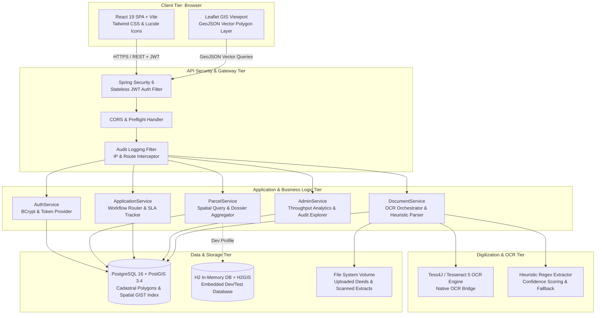
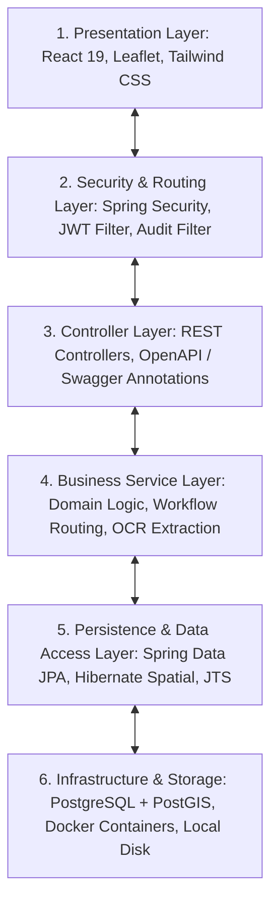
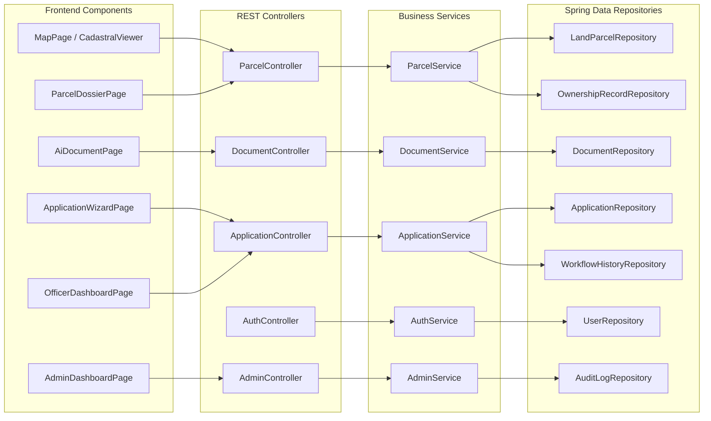
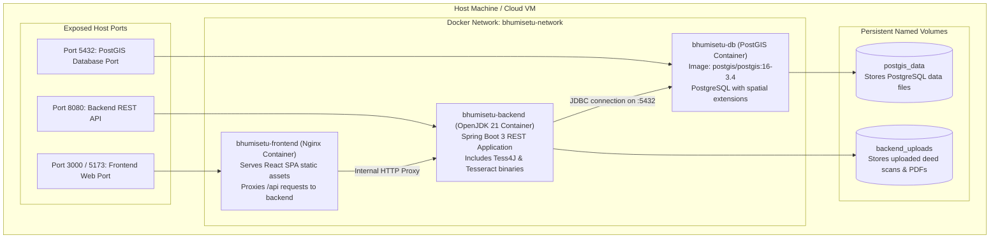
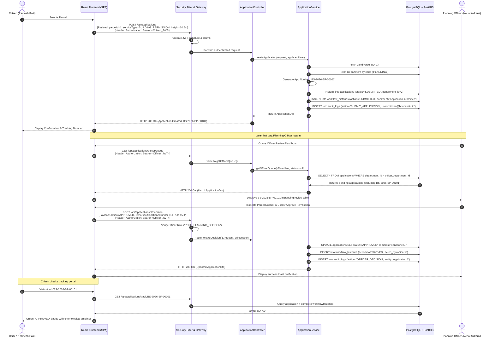

# 04. System Architecture — Bhumisetu (भूमिसेतू)

> **Academic Year:** 2026–27  
> **Project Title:** Bhumisetu: AI-Enabled, GIS-Based Integrated Land Information & Single-Window Land Service Platform  
> **Tagline:** *"One Parcel. One Window."*  

---

## What This Document Covers

This document details the architectural foundation of Bhumisetu. It illustrates the high-level system topology, provides a layered architectural breakdown from presentation to storage, diagrams software components and their communication interfaces, details containerized deployment using Docker Compose, and traces an end-to-end request lifecycle through every system boundary.

---

## 1. High-Level System Architecture

Bhumisetu is structured as a modern, decoupled client-server web platform optimized for spatial queries and asynchronous document digitization:

---

## 2. Layered Architecture Explanation

The software implements a clean **Separation of Concerns (SoC)** partitioned across six well-defined architectural layers:

### 1. Presentation Layer (Frontend Client)
* **Framework:** React 19 with Vite bundler.
* **Geospatial Rendering:** Leaflet and `react-leaflet` rendering GeoJSON polygon layers over OpenStreetMap tiles.
* **Styling & Icons:** Tailwind CSS with responsive e-governance design system (`#0B2545` deep navy, `#137547` forest green, `#DDA15E` warm gold) and Lucide React icons.
* **State Management:** Native React Context (`AuthContext`) handling session state and role privileges.

### 2. Security & Interception Layer (API Gateway)
* **Stateless Token Verification:** `AuthTokenFilter` intercepts every incoming HTTP request, validates the Bearer JWT signature against a 256-bit secret, and binds the principal to the Spring `SecurityContextHolder`.
* **Access Control:** `SecurityFilterChain` enforces route-level role checks, while `@EnableMethodSecurity` allows granular `@PreAuthorize` assertions at the method level.
* **System Auditing:** `AuditLoggingFilter` captures incoming request methods, URIs, remote IP addresses, and acting principals for immutable audit persistence.

### 3. Controller Layer (REST Web Service Tier)
* Exposes clean, standardized RESTful endpoints under `/api/*`.
* Validates incoming DTOs using Jakarta Validation annotations (`@Valid`, `@NotNull`, `@NotBlank`).
* Annotated with `io.swagger.v3` annotations, automatically generating interactive API documentation at `/swagger-ui/index.html`.

### 4. Business Service Layer (Core Domain Logic)
* **`ParcelService`:** Orchestrates spatial bounding box searches, point-in-polygon resolution, and compiles the 360-degree unified `ParcelDossierDto`.
* **`ApplicationService`:** Executes single-window application creation, generates human-readable reference numbers (e.g., `BS-2026-BP-00101`), automatically routes requests to designated departmental officer queues, and logs workflow history.
* **`DocumentService`:** Coordinates multipart file storage, triggers OCR text recognition via `Tess4J`, executes heuristic regex parsing for cadastral entities, and calculates extraction confidence scores.
* **`AuthService` & `AdminService`:** Manages user identity, password hashing via BCrypt, municipal throughput analytics, and system audit log aggregation.

### 5. Persistence & Spatial GIS Layer
* **ORM:** Spring Data JPA with Hibernate 6 and Hibernate Spatial.
* **Geometric Engine:** JTS (Java Topology Suite) `org.locationtech.jts.geom.Polygon` mapped directly to PostGIS geometries.
* **Spatial Repositories:** Leverages native SQL spatial queries (`ST_Contains`, `ST_Intersects`, `ST_MakeEnvelope`) for microsecond geospatial lookups.

### 6. Infrastructure & Storage Layer
* **Primary Database:** PostgreSQL 16 containerized with PostGIS 3.4 spatial extensions and spatial GIST indexing.
* **Development In-Memory Database:** H2 Database with H2GIS spatial functions enabled via `H2GisInitializer` for zero-setup local execution.
* **Document File Storage:** Configurable file storage volume (`/uploads` or `/app/uploads`) storing original deed PDFs and scanned property images.

---

## 3. Component Architecture

The diagram below details the concrete Spring components and React modules operating within the platform:

---

## 4. Deployment Topology (Docker Compose)

Bhumisetu is packaged for turnkey containerized deployment using Docker Compose, encapsulating the database, backend runtime, and frontend web server on an isolated bridge network:

### Docker Compose Specifications ([`docker-compose.yml`](file:///docker-compose.yml))
1. **`postgis` Service:**
   * Image: `postgis/postgis:16-3.4`
   * Healthcheck: Executes `pg_isready -U bhumisetu -d bhumisetu` every 5 seconds.
   * Persistent Volume: `postgis_data` mapped to `/var/lib/postgresql/data`.
2. **`backend` Service:**
   * Multi-stage build compiling Java 21 Spring Boot JAR and provisioning Tesseract OCR language libraries.
   * Health-dependent on `postgis` container health status.
   * Persistent Volume: `backend_uploads` mapped to `/app/uploads`.
3. **`frontend` Service:**
   * High-performance Nginx Alpine container serving production-optimized static HTML/JS/CSS assets.
   * Exposes ports `3000` and `5173`.

---

## 5. End-to-End Request Lifecycle: Building Permission Application

The following sequence diagram traces the complete lifecycle of an end-to-end user transaction: a citizen submits an application for Building Permission, which is automatically routed to the Town Planning Officer, who reviews the cadastral dossier and grants formal approval.

---

## Key Takeaways

1. **Decoupled Modern Architecture:** Strictly separates the client presentation layer (React 19, Leaflet) from the backend API, enabling independent scaling and evolution.
2. **Geospatial-First Persistence:** Utilizes PostgreSQL 16 with PostGIS 3.4 for spatial polygon storage and sub-100ms spatial geometric indexing.
3. **Stateless Security Gateway:** Employs Spring Security 6 with JWT Bearer tokens to protect API endpoints and enforce fine-grained role constraints.
4. **Turnkey Docker Topology:** Encapsulates the frontend web server, Spring Boot backend, and PostGIS database into a unified Docker Compose network with persistent storage.
5. **Traceable Request Lifecycle:** Every transactional state transition automatically records historical workflow timeline items and immutable audit logs.
