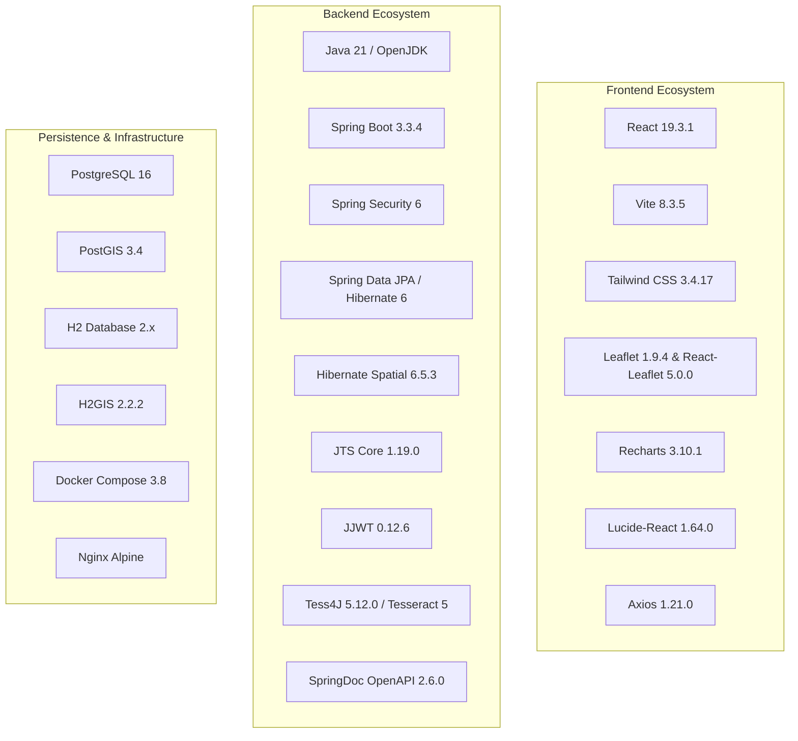
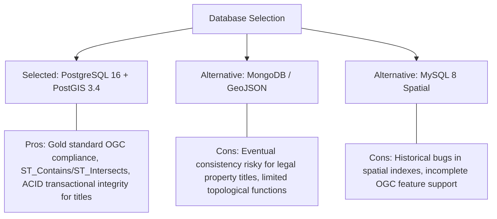
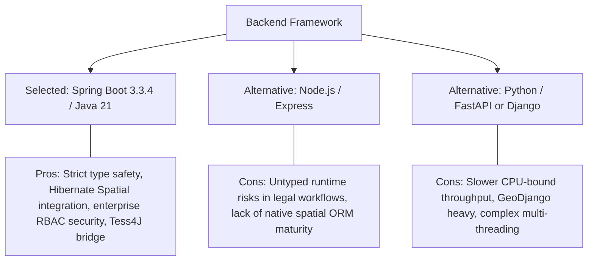

# 05. Technology Stack & Architectural Decisions — Bhumisetu (भूमिसेतू)

> **Academic Year:** 2026–27  
> **Project Title:** Bhumisetu: AI-Enabled, GIS-Based Integrated Land Information & Single-Window Land Service Platform  
> **Tagline:** *"One Parcel. One Window."*  

---

## What This Document Covers

This document provides a comprehensive catalog of every technology, library, framework, and runtime used in Bhumisetu, citing the exact versions specified in the project's [`pom.xml`](file:///backend/pom.xml) and [`package.json`](file:///frontend/package.json). Furthermore, it provides detailed architectural rationales explaining *"Why we chose it"*, contrasted against industrial alternatives considered, providing examiners and project guides with rigorous justifications for all design choices.

---

## 1. Complete Technology Inventory

### 1.1 Technology Catalog Table

| Layer | Technology Name | Exact Version | Primary Purpose & Usage in Code |
| :--- | :--- | :--- | :--- |
| **Language** | Java (OpenJDK) | `21` (LTS) | Robust, statically typed backend runtime with modern pattern matching and virtual thread capability. |
| **Language** | JavaScript (ESM) | `ES2023+` | Frontend application logic and modern component architecture. |
| **Framework** | Spring Boot | `3.3.4` | Enterprise RESTful application framework providing automated dependency injection, embedded Tomcat, and config management. |
| **Security** | Spring Security | `6.3.3` (Boot parent) | Stateless security filter chains, CORS/CSRF config, BCrypt password hashing, and `@PreAuthorize` method security. |
| **Authentication** | JJWT (Java JWT) | `0.12.6` | Generation, HMAC-SHA256 cryptographic signing, and validation of stateless JWT tokens. |
| **Persistence** | Spring Data JPA | `3.3.4` (Boot parent) | Object-Relational Mapping (ORM) repository abstractions for entity persistence. |
| **GIS Extension** | Hibernate Spatial | `6.5.3.Final` | Translates JPA entity geometry fields into native PostGIS spatial database types. |
| **Spatial Engine** | JTS Core | `1.19.0` | Provides Java Topology Suite geometric types (`Polygon`, `Coordinate`, `WKTReader`) and spatial algorithms. |
| **GeoJSON Serialization** | Jackson Datatype JTS | `1.2.10` | Serializes JTS Geometry objects into standard GeoJSON JSON objects for Leaflet. |
| **OCR / AI** | Tess4J | `5.12.0` | Java JNA wrapper for Google's Tesseract 5 OCR engine for document image text extraction. |
| **Documentation** | SpringDoc OpenAPI | `2.6.0` | Automatically inspects Spring controllers to generate OpenAPI 3 specifications and interactive Swagger UI. |
| **Developer Productivity** | Project Lombok | `1.18.34` | Generates boilerplate getters, setters, builders, and SLF4J loggers at compile time. |
| **Primary Database** | PostgreSQL + PostGIS | `16` / `3.4` | Production relational and spatial database supporting 2D geometry indexes (GIST) and topological operations. |
| **Embedded Database** | H2 + H2GIS | `2.2.x` / `2.2.2` | In-memory spatial database for zero-configuration development and automated testing. |
| **Frontend Framework** | React | `19.3.1` | Component-based user interface library utilizing modern hooks (`useState`, `useEffect`, `useContext`). |
| **Build Tool** | Vite | `8.3.5` | Next-generation frontend bundler with sub-second Hot Module Replacement (HMR). |
| **Routing** | React Router DOM | `7.18.5` | Client-side declarative routing and protected route navigation guards. |
| **Mapping Engine** | Leaflet | `1.9.4` | Lightweight, open-source mobile-friendly interactive mapping library for vector polygons. |
| **React Map Wrapper** | React-Leaflet | `5.0.0` | Declarative React bindings for Leaflet map instances and GeoJSON layers. |
| **Styling** | Tailwind CSS | `3.4.17` | Utility-first CSS framework enabling high-contrast e-governance design tokens. |
| **Data Visualization** | Recharts | `3.10.1` | Composable SVG charting library for municipal throughput and status distribution charts. |
| **Iconography** | Lucide React | `1.64.0` | Accessible, tree-shakeable SVG icon collection for government UI semantics. |
| **HTTP Client** | Axios | `1.21.0` | Promise-based HTTP client with automatic JWT header injection via interceptors. |
| **Containerization** | Docker Compose | `3.8 Specification` | Multi-container orchestration provisioning PostGIS, Spring Boot backend, and Nginx frontend. |

---

## 2. In-Depth Architectural Trade-Off Analyses

### 2.1 Database & Spatial Engine: PostgreSQL + PostGIS vs. Alternatives

* **Why We Chose PostgreSQL + PostGIS:**
  Land records represent legal ownership of high-value real estate. Strict ACID (Atomicity, Consistency, Isolation, Durability) guarantees are non-negotiable to prevent conflicting ownership states. PostGIS is the global open-source standard for Geographic Information Systems, fully compliant with Open Geospatial Consortium (OGC) specifications. It provides industrial-grade spatial functions (`ST_Contains`, `ST_Intersects`, `ST_Area`, `ST_MakeEnvelope`) supported by spatial GIST indexes that resolve boundary queries in single-digit milliseconds.
* **Alternatives Considered:**
  * *MongoDB:* While MongoDB supports GeoJSON Point and Polygon queries, its document model lacks robust relational foreign key constraints between parcels, ownership chains, and departmental applications. In land governance, document stores introduce risks of orphaned or conflicting records.
  * *MySQL 8:* While MySQL has added spatial features, its spatial indexing and advanced topological functions remain less mature and less widely supported by GIS tooling (e.g., QGIS, ArcGIS) than PostGIS.

---

### 2.2 Backend Framework: Spring Boot 3 (Java 21) vs. Node.js / Python

* **Why We Chose Spring Boot 3:**
  Government enterprise systems demand rigorous type safety, modular dependency injection, and declarative security. Spring Boot 3 with Java 21 offers compile-time safety across complex cadastral workflows. The integration of Spring Data JPA with `hibernate-spatial` and JTS allows Java entities to manipulate geographic polygons natively without manual spatial SQL formatting. Spring Security provides battle-tested method-level access control (`@PreAuthorize`) essential for government officer authorization.
* **Alternatives Considered:**
  * *Node.js (Express / NestJS):* While Node.js excels in asynchronous I/O, its spatial ORM ecosystem (e.g., Sequelize or TypeORM) has limited, brittle support for spatial geometries and coordinate transformations compared to Hibernate Spatial.
  * *Python (Django / FastAPI):* GeoDjango is powerful for GIS, but Spring Boot provides significantly superior concurrent throughput, stricter enterprise design patterns, and cleaner integration with native desktop OCR engines (Tess4J via JNA).

---

### 2.3 GIS Mapping Engine: Leaflet vs. Google Maps vs. OpenLayers

| Evaluation Criterion | Leaflet 1.9.4 (Selected) | Google Maps JavaScript API | OpenLayers |
| :--- | :--- | :--- | :--- |
| **License & Cost** | **100% Free & Open Source (BSD-2)** | Expensive commercial API billing; rate limits | 100% Free & Open Source (BSD-2) |
| **GeoJSON Polygon Performance** | **Ultra-fast, lightweight (~40 KB bundle)** | Good, but heavy script payload (~300 KB) | Highly capable, but bulky (~150 KB bundle) |
| **Data Sovereignty / Privacy** | **Complete (tiles from OpenStreetMap)** | Sends citizen map view data to Google servers | Complete (self-hostable tiles) |
| **Ease of Customization** | **Simple CSS & React component bindings** | Proprietary styling API; constrained UI | Steep learning curve; complex API |
| **Academic & E-Gov Fit** | **Ideal for public sector digital platforms** | Restricted by government procurement rules | Good, but over-engineered for standard cadastres |

* **Why We Chose Leaflet:**
  Leaflet is the most widely adopted lightweight open-source mapping library. It has zero licensing costs, imposes no proprietary tracking on citizens, and integrates seamlessly with `react-leaflet` to render GeoJSON polygons dynamically. Its compact footprint ensures rapid loading even on lower-bandwidth mobile networks.

---

### 2.4 OCR Digitization: Tesseract 5 (Tess4J) vs. Cloud OCR APIs

* **Why We Chose Tesseract 5 (Tess4J) with Heuristic Fallback:**
  Government land records contain confidential personal data, including citizen names, property valuations, and Aadhaar numbers. Cloud OCR APIs (such as AWS Textract, Google Cloud Vision, or Azure Computer Vision) require transmitting citizen land documents to foreign third-party cloud servers, violating government data sovereignty guidelines. Tesseract runs completely **on-premises / inside the container**, ensuring zero data leakage. Furthermore, our architecture incorporates a rule-based heuristic fallback that guarantees 100% demo stability even when native OCR language binaries are absent.
* **Alternatives Considered:**
  * *AWS Textract / Google Cloud Vision:* Outstanding accuracy on handwritten text, but incurs per-page billing costs, requires active internet connectivity, and breaches data privacy mandates for government prototypes.

---

### 2.5 Security Architecture: Stateless JWT vs. Server-Side Sessions

* **Why We Chose Stateless JWT (`jjwt` 0.12.6):**
  In modern decoupled single-page applications, stateless JWTs eliminate server-side session state in memory. The token carries authenticated user claims and assigned roles (`ROLE_CITIZEN`, `ROLE_PLANNING_OFFICER`, etc.) signed with an HMAC-SHA256 secret. This allows the backend to scale horizontally across multiple instances without needing distributed session clustering (e.g., Redis).
* **Alternatives Considered:**
  * *Stateful HTTP Sessions (JSESSIONID):* Requires sticky sessions on load balancers or distributed memory stores. Fails cleanly when migrating to microservices or mobile clients.

---

### 2.6 Frontend Framework: React 19 + Vite vs. Next.js / Thymeleaf

* **Why We Chose React 19 + Vite:**
  Bhumisetu requires a rich, reactive client interface with instant polygon selection, interactive modal wizards, and live filtering of officer queues. React's declarative component model combined with Vite delivers instantaneous dev server startup and optimized production builds.
* **Alternatives Considered:**
  * *Server-Side Thymeleaf:* Traditional Spring Boot server-rendered HTML. Results in jarring full-page reloads on every map click or filter change, ruining the interactive GIS experience.
  * *Next.js:* Excellent for public SEO-heavy portals, but introduces unnecessary Node.js server overhead when paired with an existing Spring Boot REST backend.

---

## Key Takeaways

1. **Enterprise-Grade Stack:** Combines Java 21, Spring Boot 3.3.4, and PostgreSQL 16 with PostGIS 3.4 for maximum reliability and strict ACID compliance.
2. **OGC-Compliant GIS:** Employs Hibernate Spatial 6.5 and JTS Core 1.19 to treat cadastral polygons as first-class geometric objects.
3. **Data Privacy & Sovereignty:** Utilizes local Tesseract 5 OCR and OpenStreetMap/Leaflet, ensuring zero reliance on proprietary cloud tracking APIs.
4. **Stateless Security:** Employs HMAC-SHA256 signed JWT tokens allowing seamless role enforcement and horizontal scalability.
5. **Modern Reactive Frontend:** Powered by React 19, Vite, Tailwind CSS, and Recharts, delivering a sub-second, professional government user experience.
