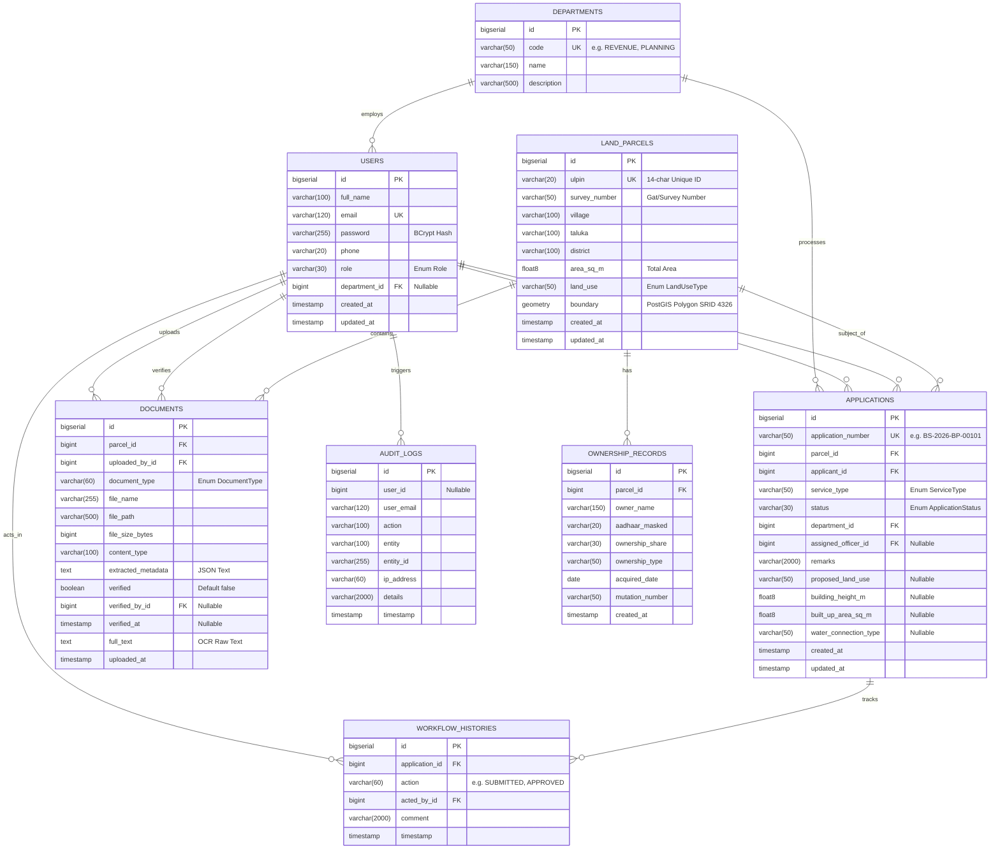

# 06. Database Design & Spatial GIS — Bhumisetu (भूमिसेतू)

> **Academic Year:** 2026–27  
> **Project Title:** Bhumisetu: AI-Enabled, GIS-Based Integrated Land Information & Single-Window Land Service Platform  
> **Tagline:** *"One Parcel. One Window."*  

---

## What This Document Covers

This document details the relational and geospatial database architecture of Bhumisetu. It features a complete Entity-Relationship (ER) diagram, comprehensive data dictionaries for all eight production database tables, an explanation of PostGIS spatial geometries (WGS-84 SRID 4326, WKT, GIST indexes), sample spatial queries used in the backend, and an architectural defense of why the entire platform is anchored around the land parcel entity.

---

## 1. Entity-Relationship (ER) Diagram

The following Mermaid diagram illustrates all eight database entities, their primary keys, foreign key relationships, and cardinalities as implemented in the Java entity models:



---

## 2. Comprehensive Data Dictionary

### 2.1 Table: `land_parcels`
Stores official cadastral boundary polygons, geographic identifiers, and zoning designations.

| Column | Data Type | Constraints | Description |
| :--- | :--- | :--- | :--- |
| `id` | `BIGSERIAL` | `PRIMARY KEY` | Unique synthetic database identifier. |
| `ulpin` | `VARCHAR(20)` | `NOT NULL, UNIQUE` | Standard 14-char Unique Land Parcel Identification Number (e.g., `MH-PUN-HIN-001`). |
| `survey_number` | `VARCHAR(50)` | `NOT NULL` | Revenue Survey or Gat Number (e.g., `125/2`, `48/1A`). |
| `village` | `VARCHAR(100)` | `NOT NULL` | Revenue village name (e.g., `Hinjewadi`, `Wakad`, `Baner`). |
| `taluka` | `VARCHAR(100)` | `NOT NULL` | Sub-district / administrative taluka (e.g., `Mulshi`, `Haveli`). |
| `district` | `VARCHAR(100)` | `NOT NULL` | Administrative district (e.g., `Pune`). |
| `area_sq_m` | `DOUBLE PRECISION` | `NOT NULL` | Official registered land area in square meters. |
| `land_use` | `VARCHAR(50)` | `NOT NULL` | Master plan zoning (`RESIDENTIAL`, `COMMERCIAL`, `AGRICULTURAL`, `INDUSTRIAL`, `PUBLIC_UTILITY`, `MIXED_USE`). |
| `boundary` | `GEOMETRY(Polygon, 4326)` | `NOT NULL` | PostGIS spatial polygon boundary in WGS-84 coordinate system. |
| `created_at` | `TIMESTAMP` | `NOT NULL` | Record initialization timestamp. |
| `updated_at` | `TIMESTAMP` | `NULLABLE` | Last modification timestamp. |

---

### 2.2 Table: `ownership_records`
Stores title ownership stakes, mutation numbers, and owner demographics linked to each parcel.

| Column | Data Type | Constraints | Description |
| :--- | :--- | :--- | :--- |
| `id` | `BIGSERIAL` | `PRIMARY KEY` | Unique identifier. |
| `parcel_id` | `BIGINT` | `NOT NULL, FK` | References `land_parcels(id)` (`ON DELETE CASCADE`). |
| `owner_name` | `VARCHAR(150)` | `NOT NULL` | Full legal name of the property owner. |
| `aadhaar_masked` | `VARCHAR(20)` | `NULLABLE` | Privacy-compliant masked national ID (e.g., `XXXX-XXXX-4819`). |
| `ownership_share` | `VARCHAR(30)` | `NULLABLE` | Fractional or percentage stake (e.g., `100%`, `50%`, `1/3rd`). |
| `ownership_type` | `VARCHAR(50)` | `NULLABLE` | Legal tenure type (`INDIVIDUAL`, `JOINT`, `ANCESTRAL`, `CORPORATE`). |
| `acquired_date` | `DATE` | `NULLABLE` | Date of legal acquisition or registration. |
| `mutation_number` | `VARCHAR(50)` | `NULLABLE` | Revenue mutation extract reference (e.g., `MUT-2021-9871`). |
| `created_at` | `TIMESTAMP` | `NOT NULL` | Record creation timestamp. |

---

### 2.3 Table: `documents`
Stores physical file references, OCR extracted text, and verification statuses for land records.

| Column | Data Type | Constraints | Description |
| :--- | :--- | :--- | :--- |
| `id` | `BIGSERIAL` | `PRIMARY KEY` | Unique identifier. |
| `parcel_id` | `BIGINT` | `NOT NULL, FK` | References `land_parcels(id)`. |
| `uploaded_by_id`| `BIGINT` | `NOT NULL, FK` | References `users(id)`. |
| `document_type` | `VARCHAR(60)` | `NOT NULL` | Legal document type (`EXTRACT_7_12`, `MUTATION_8_A`, `SALE_DEED`, `BUILDING_PLAN`, etc.). |
| `file_name` | `VARCHAR(255)` | `NOT NULL` | Original filename of uploaded scan/PDF. |
| `file_path` | `VARCHAR(500)` | `NOT NULL` | Relative disk storage path (e.g., `/uploads/sample_7_12_extract.jpg`). |
| `file_size_bytes`| `BIGINT` | `NULLABLE` | File size in bytes. |
| `content_type` | `VARCHAR(100)` | `NULLABLE` | MIME type (e.g., `image/jpeg`, `application/pdf`). |
| `extracted_metadata`| `TEXT` | `NULLABLE` | JSON string storing parsed fields and confidence scores. |
| `verified` | `BOOLEAN` | `NOT NULL, DEFAULT FALSE`| Verification flag set by user or municipal officer. |
| `verified_by_id`| `BIGINT` | `NULLABLE, FK` | References `users(id)` of confirming officer. |
| `verified_at` | `TIMESTAMP` | `NULLABLE` | Timestamp of formal verification. |
| `full_text` | `TEXT` | `NULLABLE` | Complete raw text output produced by Tesseract OCR for smart full-text indexing. |
| `uploaded_at` | `TIMESTAMP` | `NOT NULL` | Upload timestamp. |

---

### 2.4 Table: `applications`
Tracks single-window citizen applications, departmental assignments, and workflow statuses.

| Column | Data Type | Constraints | Description |
| :--- | :--- | :--- | :--- |
| `id` | `BIGSERIAL` | `PRIMARY KEY` | Unique identifier. |
| `application_number`| `VARCHAR(50)`| `NOT NULL, UNIQUE`| Human-readable tracking number (e.g., `BS-2026-BP-00101`). |
| `parcel_id` | `BIGINT` | `NOT NULL, FK` | References `land_parcels(id)`. |
| `applicant_id` | `BIGINT` | `NOT NULL, FK` | References `users(id)` of the citizen applicant. |
| `service_type` | `VARCHAR(50)` | `NOT NULL` | `BUILDING_PERMISSION`, `LAND_USE_CHANGE`, or `WATER_CONNECTION`. |
| `status` | `VARCHAR(30)` | `NOT NULL` | `SUBMITTED`, `UNDER_REVIEW`, `INFO_REQUESTED`, `APPROVED`, `REJECTED`. |
| `department_id` | `BIGINT` | `NOT NULL, FK` | References `departments(id)` responsible for processing. |
| `assigned_officer_id`| `BIGINT` | `NULLABLE, FK` | References `users(id)` of officer handling scrutiny. |
| `remarks` | `VARCHAR(2000)`| `NULLABLE` | Official decision remarks or citizen instructions. |
| `proposed_land_use`| `VARCHAR(50)`| `NULLABLE` | Proposed zoning for NA conversion requests. |
| `building_height_m`| `DOUBLE PRECISION`| `NULLABLE`| Proposed structural height in meters (for building permission). |
| `built_up_area_sq_m`| `DOUBLE PRECISION`| `NULLABLE`| Total floor space / built-up area in square meters. |
| `water_connection_type`| `VARCHAR(50)`| `NULLABLE`| `DOMESTIC_RESIDENTIAL` or `COMMERCIAL_INDUSTRIAL`. |
| `created_at` | `TIMESTAMP` | `NOT NULL` | Submission timestamp. |
| `updated_at` | `TIMESTAMP` | `NULLABLE` | Last workflow transition timestamp. |

---

### 2.5 Table: `departments`
Stores municipal and revenue department definitions and jurisdictional codes.

| Column | Data Type | Constraints | Description |
| :--- | :--- | :--- | :--- |
| `id` | `BIGSERIAL` | `PRIMARY KEY` | Unique identifier. |
| `code` | `VARCHAR(50)` | `NOT NULL, UNIQUE` | Short uppercase code (`REVENUE`, `PLANNING`, `TREE`, `UTILITY`). |
| `name` | `VARCHAR(150)` | `NOT NULL` | Full official department title. |
| `description` | `VARCHAR(500)` | `NULLABLE` | Administrative responsibilities and scope. |

---

### 2.6 Table: `users`
Stores user identities, hashed credentials, contact details, and role assignments.

| Column | Data Type | Constraints | Description |
| :--- | :--- | :--- | :--- |
| `id` | `BIGSERIAL` | `PRIMARY KEY` | Unique identifier. |
| `full_name` | `VARCHAR(100)` | `NOT NULL` | Legal full name. |
| `email` | `VARCHAR(120)` | `NOT NULL, UNIQUE` | Official email address used as the login principal. |
| `password` | `VARCHAR(255)` | `NOT NULL` | Salted BCrypt password hash. |
| `phone` | `VARCHAR(20)` | `NULLABLE` | Contact telephone number. |
| `role` | `VARCHAR(30)` | `NOT NULL` | `CITIZEN`, `REVENUE_OFFICER`, `PLANNING_OFFICER`, `TREE_OFFICER`, `UTILITY_OFFICER`, `ADMIN`. |
| `department_id` | `BIGINT` | `NULLABLE, FK` | References `departments(id)` (officers only). |
| `created_at` | `TIMESTAMP` | `NOT NULL` | Account registration timestamp. |
| `updated_at` | `TIMESTAMP` | `NULLABLE` | Profile update timestamp. |

---

### 2.7 Table: `workflow_histories`
Stores the complete, chronological audit trail of state transitions for every land application.

| Column | Data Type | Constraints | Description |
| :--- | :--- | :--- | :--- |
| `id` | `BIGSERIAL` | `PRIMARY KEY` | Unique identifier. |
| `application_id`| `BIGINT` | `NOT NULL, FK` | References `applications(id)` (`ON DELETE CASCADE`). |
| `action` | `VARCHAR(60)` | `NOT NULL` | Workflow state action (`SUBMITTED`, `UNDER_REVIEW`, `APPROVED`, etc.). |
| `acted_by_id` | `BIGINT` | `NOT NULL, FK` | References `users(id)` who executed the transition. |
| `comment` | `VARCHAR(2000)`| `NULLABLE` | Officer rationale or submission note. |
| `timestamp` | `TIMESTAMP` | `NOT NULL` | Exact transition timestamp. |

---

### 2.8 Table: `audit_logs`
Provides an immutable security audit log capturing user actions, target entities, and client IP addresses.

| Column | Data Type | Constraints | Description |
| :--- | :--- | :--- | :--- |
| `id` | `BIGSERIAL` | `PRIMARY KEY` | Unique identifier. |
| `user_id` | `BIGINT` | `NULLABLE` | ID of acting user (`null` for anonymous operations). |
| `user_email` | `VARCHAR(120)` | `NULLABLE` | Email of acting user. |
| `action` | `VARCHAR(100)` | `NOT NULL` | Event code (`LOGIN`, `VIEW_PARCEL`, `UPLOAD_DOC`, `OFFICER_DECISION`, etc.). |
| `entity` | `VARCHAR(100)` | `NULLABLE` | Affected entity class (`LandParcel`, `Application`, `Document`). |
| `entity_id` | `VARCHAR(255)` | `NULLABLE` | Identifier of affected entity. |
| `ip_address` | `VARCHAR(60)` | `NULLABLE` | Client IPv4/IPv6 address. |
| `details` | `VARCHAR(2000)`| `NULLABLE` | Additional context or state change details. |
| `timestamp` | `TIMESTAMP` | `NOT NULL` | Immutable log creation timestamp. |

---

## 3. PostGIS Spatial Representation & Queries

### 3.1 Geometric Representation
Cadastral parcel boundaries are stored as closed 2D polygons in PostGIS using the **WGS-84 Coordinate Reference System (EPSG:4326)**:
* **Well-Known Text (WKT):** A human-readable text markup language for representing geometric objects. Example of a parcel boundary in Hinjewadi:
  ```text
  POLYGON((73.7180 18.5910, 73.7210 18.5910, 73.7210 18.5880, 73.7180 18.5880, 73.7180 18.5910))
  ```
  *Note:* The polygon coordinate sequence must be closed (the first vertex and last vertex are identical: `73.7180 18.5910`). Coordinates are expressed as `(Longitude, Latitude)`.
* **Spatial GIST Indexing:** To avoid expensive sequential table scans over geometric polygons, PostgreSQL builds a Generalized Search Tree (GIST) index over the boundary column:
  ```sql
  CREATE INDEX idx_land_parcels_boundary ON land_parcels USING GIST (boundary);
  ```

---

### 3.2 Key Spatial Queries Used in Bhumisetu

#### 1. Point-in-Polygon Query (Map Click to Parcel)
Executed when a citizen clicks any arbitrary coordinate on the Leaflet map:
```sql
SELECT p.id, p.ulpin, p.survey_number, p.village, p.area_sq_m, p.land_use
FROM land_parcels p
WHERE ST_Contains(p.boundary, ST_SetSRID(ST_Point(:lon, :lat), 4326));
```
* **Explanation:** `ST_Point(:lon, :lat)` constructs a 2D geometric point from the clicked coordinates, `ST_SetSRID(..., 4326)` tags it with WGS-84, and `ST_Contains` uses the spatial GIST index to find the containing polygon in sub-millisecond time.

#### 2. Spatial Bounding Box Intersect (Viewport Query)
Executed when the client browser pans or zooms the map viewport:
```sql
SELECT p.id, p.ulpin, p.survey_number, p.village, p.area_sq_m, p.land_use
FROM land_parcels p
WHERE ST_Intersects(p.boundary, ST_MakeEnvelope(:minLon, :minLat, :maxLon, :maxLat, 4326));
```
* **Explanation:** `ST_MakeEnvelope` defines a rectangular bounding box from the client viewport corners. `ST_Intersects` retrieves all parcels overlapping that viewport.

#### 3. GeoJSON Feature Collection Generation
Executed to stream vector layers directly to Leaflet:
```sql
SELECT json_build_object(
    'type', 'FeatureCollection',
    'features', json_agg(
        json_build_object(
            'type', 'Feature',
            'id', p.id,
            'geometry', ST_AsGeoJSON(p.boundary)::json,
            'properties', json_build_object(
                'ulpin', p.ulpin,
                'surveyNumber', p.survey_number,
                'village', p.village,
                'areaSqM', p.area_sq_m,
                'landUse', p.land_use
            )
        )
    )
) FROM land_parcels p;
```

---

## 4. Why the Design is Parcel-Centric

Traditional government software architectures are **department-centric**:
* The Revenue Department maintains an application table keyed by *Challan Number*.
* The Town Planning Department maintains a table keyed by *Sanction File Number*.
* The Water Utility maintains a table keyed by *Consumer Meter Number*.

When a citizen applies for building sanction, the town planning engineer cannot see that the revenue department has a pending title dispute, because the two systems have no common key.

### The Bhumisetu Paradigm Shift
In Bhumisetu, the **Land Parcel** (anchored by its physical geospatial boundary and immutable ULPIN) is the root aggregate entity. Everything else is a foreign key child:
1. **Ownerships** hang off the parcel (`ownership_records.parcel_id`).
2. **Scanned Title Deeds and 7/12 Extracts** hang off the parcel (`documents.parcel_id`).
3. **Building and Utility Applications** hang off the parcel (`applications.parcel_id`).

### Key Benefits
* **Complete Title Visibility:** Opening a parcel dossier reveals ownership, verified documents, utility sanctions, and pending municipal applications in a single query.
* **Spatial Truth:** Physical boundaries cannot be duplicated or falsified because PostGIS enforces geometric validity.
* **Immunity to Departmental Reorganizations:** When municipal boundaries or department names change, the land parcel's physical coordinates remain permanent.

---

## Key Takeaways

1. **Eight Relational Entities:** Normalized JPA data model connecting Parcels, Ownerships, Documents, Applications, Departments, Users, Workflow Histories, and Audit Logs.
2. **PostGIS Polygon Geometry:** Boundaries are stored in EPSG:4326 (WGS-84) and accelerated with spatial GIST indexes for sub-millisecond point-in-polygon queries.
3. **Parcel-Centric Architecture:** All legal, municipal, and utility records hang off the canonical land parcel entity, eliminating departmental data fragmentation.
4. **Complete Workflow Auditing:** State transitions are permanently recorded in `workflow_histories` while security actions are captured in `audit_logs`.
5. **JSON-Enabled Text Search:** OCR text is indexed in `documents.full_text` while parsed key-value attributes are preserved in `extracted_metadata`.
