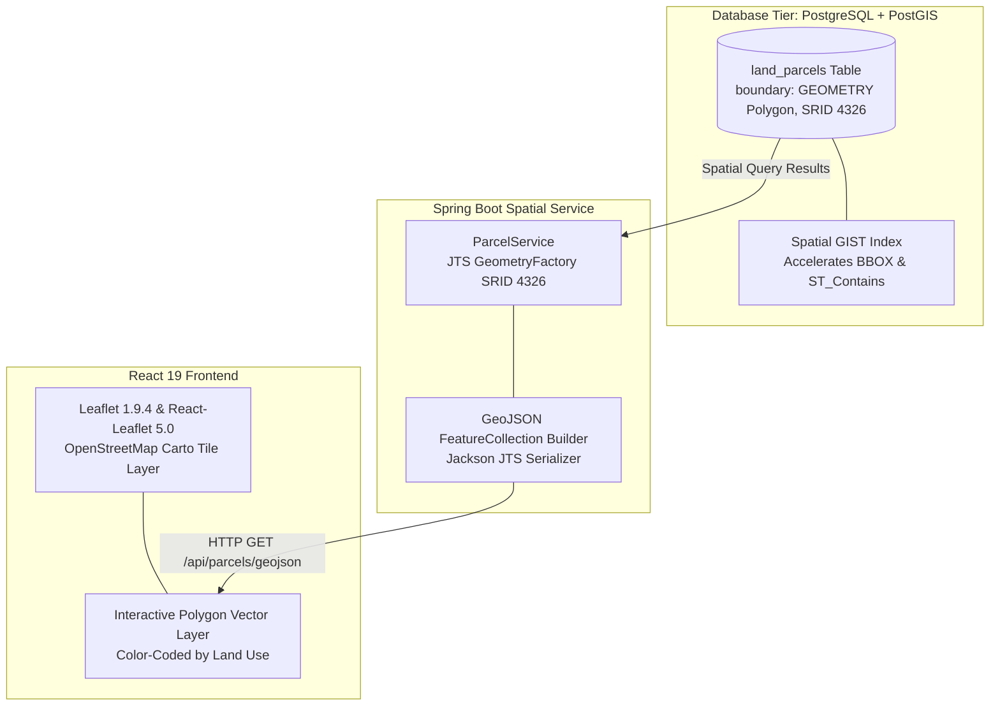
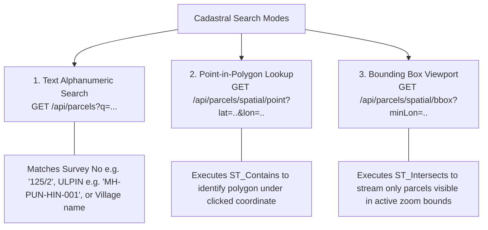
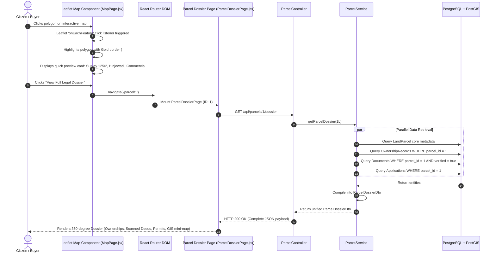

# 08. GIS & Cadastral Mapping Module — Bhumisetu (भूमिसेतू)

> **Academic Year:** 2026–27  
> **Project Title:** Bhumisetu: AI-Enabled, GIS-Based Integrated Land Information & Single-Window Land Service Platform  
> **Tagline:** *"One Parcel. One Window."*  

---

## What This Document Covers

This document details the Geographic Information System (GIS) and cadastral mapping subsystem of Bhumisetu. It explains how land parcels are spatially stored in PostGIS using the WGS-84 coordinate system, transformed and served via RESTful GeoJSON layers, rendered client-side on interactive Leaflet maps with dynamic land-use color palettes, searched across spatial and alphanumeric dimensions, and seamlessly navigated via an intuitive Map-to-Dossier interaction flow.

---

## 1. Cadastral Spatial Storage (PostGIS Architecture)

In traditional revenue portals, land plots are referenced solely by alphanumeric strings (e.g., *"Survey 125/2, Village Hinjewadi"*). This alphanumeric abstraction fails to capture physical layout, spatial adjacency, encroachment risks, or environmental overlays.

Bhumisetu enforces a **geospatial-first** cadastral model:
* **Spatial Geometry Type:** Every land parcel stores its geographic perimeter as a 2D `Polygon` within the `boundary` column of the `land_parcels` table.
* **Coordinate Reference System (CRS):** Polygons are defined using **WGS-84 (World Geodetic System 1984)**, designated by standard **EPSG / SRID 4326**. Coordinates are represented as decimal degrees: `(Longitude, Latitude)`.
* **Geometry Engine (JTS):** The Spring Boot backend leverages the Java Topology Suite (`org.locationtech.jts.geom.Polygon` and `org.locationtech.jts.geom.PrecisionModel`) mapped seamlessly through `hibernate-spatial:6.5.3.Final`.
* **Spatial GIST Indexing:** A Generalized Search Tree (GIST) index is maintained on the `boundary` column, enabling rapid bounding box filtering and microsecond topological queries:
  ```sql
  CREATE INDEX idx_land_parcels_boundary ON land_parcels USING GIST (boundary);
  ```



---

## 2. Serving Cadastral Data as GeoJSON

To enable standard web mapping engines to render vector parcels without proprietary plugins, the backend serves parcels as a compliant **GeoJSON FeatureCollection** via the public endpoint:

`GET /api/parcels/geojson`

### GeoJSON Serialization Process
Implemented in [`ParcelService.java`](file:///backend/src/main/java/in/bhumisetu/service/ParcelService.java#L83-L133):
1. **Coordinate Extraction:** Iterates through the polygon's exterior ring coordinates (`poly.getExteriorRing().getCoordinates()`), converting each JTS `Coordinate` into a `[longitude, latitude]` pair.
2. **Centroid Calculation:** Automatically calculates the geographic centroid point (`poly.getCentroid()`) to provide anchor coordinates for map labeling, popups, and camera centering.
3. **Property Embedding:** Injects essential cadastral and administrative properties into each Feature payload:
   * `id`: Synthetic parcel database ID.
   * `ulpin`: 14-character Unique Land Parcel Identification Number.
   * `surveyNumber`: Gat/Survey number (e.g., `125/2`).
   * `village`, `taluka`, `district`: Administrative hierarchy.
   * `areaSqM`: Registered plot area in square meters.
   * `landUse`: Official zoning classification.
   * `primaryOwner`: Primary title holder extracted from ownership records.
   * `documentCount`: Number of verified digital documents attached.
   * `applicationCount`: Active municipal service applications.

### Sample GeoJSON Feature Payload
```json
{
  "type": "FeatureCollection",
  "features": [
    {
      "type": "Feature",
      "id": 1,
      "geometry": {
        "type": "Polygon",
        "coordinates": [
          [
            [73.7180, 18.5910],
            [73.7210, 18.5910],
            [73.7210, 18.5880],
            [73.7180, 18.5880],
            [73.7180, 18.5910]
          ]
        ]
      },
      "properties": {
        "id": 1,
        "ulpin": "MH-PUN-HIN-001",
        "surveyNumber": "125/2",
        "village": "Hinjewadi",
        "taluka": "Mulshi",
        "district": "Pune",
        "areaSqM": 3450.0,
        "landUse": "COMMERCIAL",
        "primaryOwner": "Ramesh Narayan Patil",
        "centroidLat": 18.5895,
        "centroidLon": 73.7195,
        "documentCount": 3,
        "applicationCount": 2
      }
    }
  ]
}
```

---

## 3. Client-Side Rendering with Leaflet

Client-side rendering is handled by Leaflet 1.9.4 and `react-leaflet:5.0.0` inside [`MapPage.jsx`](file:///frontend/src/pages/MapPage.jsx):

* **Base Map Layer:** High-contrast OpenStreetMap cartographic tiles (`https://{s}.tile.openstreetmap.org/{z}/{x}/{y}.png`) served with standard caching headers.
* **Vector Polygon Layer:** A `GeoJSON` vector layer consumes the `/api/parcels/geojson` endpoint, binding dynamic mouse hover and click events.
* **Responsive Viewport Controls:** Provides zoom-in, zoom-out, full-extent reset buttons, and a layer toggle for zoning filters.

### Land Use Color Palette
To immediately communicate zoning and master plan classifications, parcel polygons are color-coded based on the `landUse` property:

| Land Use Classification | Hex Color Code | Visual Semantics & Description |
| :--- | :--- | :--- |
| **`RESIDENTIAL`** | `#2563EB` (Royal Blue) | Private housing, residential townships, and apartment complexes. |
| **`COMMERCIAL`** | `#D97706` (Amber / Gold) | IT parks, shopping plazas, commercial office spaces. |
| **`AGRICULTURAL`** | `#16A34A` (Forest Green) | Cultivated farmland, orchards, green zone holdings. |
| **`INDUSTRIAL`** | `#9333EA` (Purple) | Manufacturing facilities, warehouses, MIDC industrial estates. |
| **`PUBLIC_UTILITY`** | `#0891B2` (Cyan) | Sub-stations, water filtration plants, civic amenity plots. |
| **`MIXED_USE`** | `#E11D48` (Rose Red) | Ground-floor commercial with residential apartments above. |

*Styling Configuration:*
* **Normal State:** `fillOpacity: 0.45`, `weight: 2`, `color: '#FFFFFF'`.
* **Hover State:** `fillOpacity: 0.75`, `weight: 3`, `color: '#0B2545'` (triggers interactive tooltip with owner name and survey number).
* **Selected State:** `fillOpacity: 0.85`, `weight: 4`, `color: '#DDA15E'` with animated pulsing border.

---

## 4. Cadastral Search Capabilities

Bhumisetu provides three distinct modes for locating cadastral parcels:



1. **Alphanumeric Search (`GET /api/parcels?q={query}`):**
   Case-insensitive partial matching across Survey Number, ULPIN, and Village name using JPQL:
   ```sql
   SELECT p FROM LandParcel p
   WHERE LOWER(p.surveyNumber) LIKE LOWER(CONCAT('%', :query, '%'))
      OR LOWER(p.ulpin) LIKE LOWER(CONCAT('%', :query, '%'))
      OR LOWER(p.village) LIKE LOWER(CONCAT('%', :query, '%'))
   ```
2. **Point-in-Polygon Query (`GET /api/parcels/spatial/point?lat={lat}&lon={lon}`):**
   Converts clicked map GPS coordinates into a JTS `Point` and queries PostGIS using `ST_Contains(boundary, point)` to return the exact containing plot.
3. **Bounding Box Viewport Query (`GET /api/parcels/spatial/bbox`):**
   Accepts four coordinates (`minLon`, `minLat`, `maxLon`, `maxLat`), constructs an envelope polygon, and queries `ST_Intersects` to stream only parcels within the active browser viewport.

---

## 5. Map-to-Dossier Interaction Flow

The core design philosophy of Bhumisetu is direct, zero-friction transition from spatial exploration to legal truth. The sequence diagram below traces how a citizen navigates from clicking a polygon on the map to inspecting the full Parcel Dossier:



---

## Key Takeaways

1. **Geospatial-First Storage:** Parcel boundaries are stored as native 2D Polygon geometries in PostGIS (SRID 4326), backed by spatial GIST indexes.
2. **Open Standard GeoJSON:** Exposes standard GeoJSON FeatureCollections, allowing any modern client mapping library to render vector plots effortlessly.
3. **Semantic Land-Use Styling:** Visual color palettes immediately distinguish Residential, Commercial, Agricultural, Industrial, Public Utility, and Mixed-Use land classifications.
4. **Multi-Modal Discovery:** Supports alphanumeric string searching, geographic point-in-polygon resolution, and viewport bounding-box intersects.
5. **Direct Map-to-Dossier Navigation:** Clicking any spatial polygon opens the 360-degree legal dossier, bridging physical map boundaries with administrative records.
