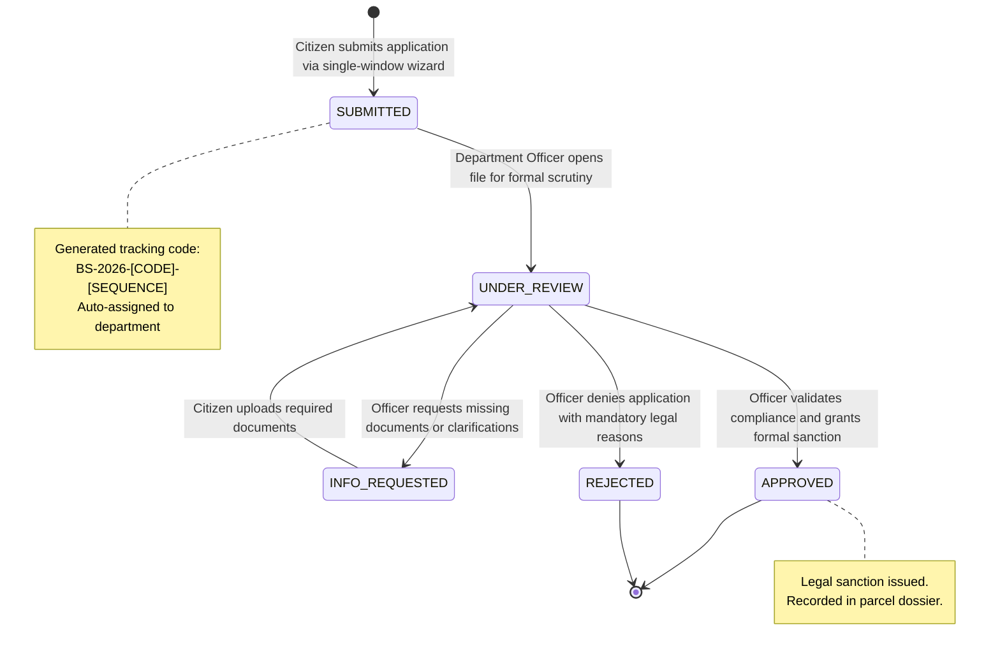
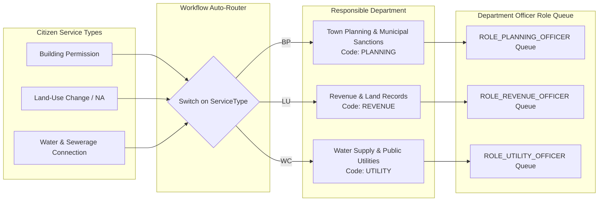
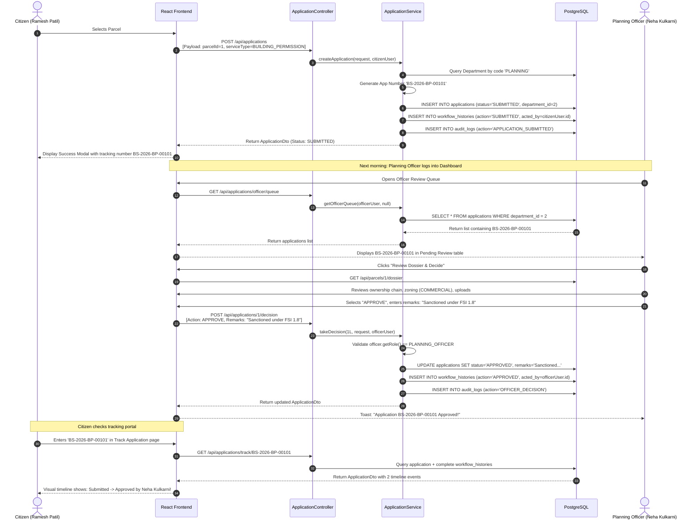
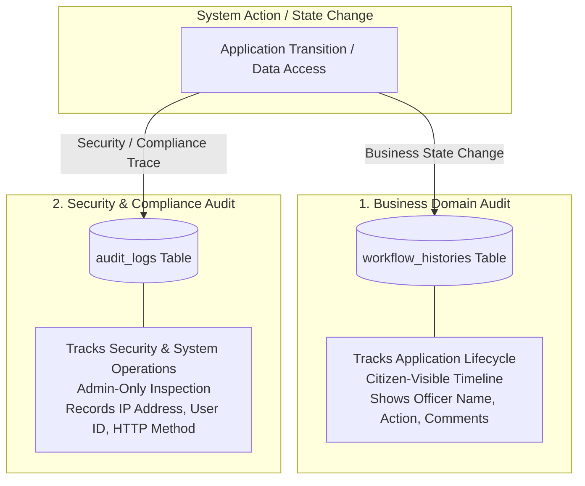

# 10. Single-Window Workflow Engine — Bhumisetu (भूमिसेतू)

> **Academic Year:** 2026–27  
> **Project Title:** Bhumisetu: AI-Enabled, GIS-Based Integrated Land Information & Single-Window Land Service Platform  
> **Tagline:** *"One Parcel. One Window."*  

---

## What This Document Covers

This document provides a comprehensive technical breakdown of the Single-Window Workflow Engine in Bhumisetu. It models the application lifecycle state machine, explains the deterministic routing table directing citizen service requests to municipal departments, diagrams the complete approval lifecycle, and contrasts the dual-auditing architecture composed of citizen-facing `WorkflowHistory` timelines and administrative `AuditLog` security records.

---

## 1. Application Lifecycle State Machine

Every land service application submitted through Bhumisetu progresses through a deterministic Finite State Machine (FSM) governed by `in.bhumisetu.domain.enums.ApplicationStatus`:

### State Definitions & Trigger Events

| Application Status | Triggering Event | Authorized Persona | Next Allowable States |
| :--- | :--- | :--- | :--- |
| **`SUBMITTED`** | Citizen completes the application wizard and uploads supporting files. | `ROLE_CITIZEN` | `UNDER_REVIEW` |
| **`UNDER_REVIEW`** | Department officer opens the application from their queue and initiates technical scrutiny. | Departmental Officer (`PLANNING`, `REVENUE`, `UTILITY`) or `ADMIN` | `INFO_REQUESTED`, `APPROVED`, `REJECTED` |
| **`INFO_REQUESTED`** | Officer discovers discrepancies (e.g., missing structural certificate, unverified mutation) and demands clarification. | Departmental Officer or `ADMIN` | `UNDER_REVIEW` |
| **`APPROVED`** | Officer confirms regulatory compliance and issues official municipal sanction. | Departmental Officer or `ADMIN` | Terminal State |
| **`REJECTED`** | Officer rejects the proposal due to non-compliance with bylaws or zoning restrictions. | Departmental Officer or `ADMIN` | Terminal State |

---

## 2. Deterministic Departmental Routing Table

In traditional municipal administration, citizens frequently submit applications to the wrong office or desk. Bhumisetu completely eliminates misdirection through **automated rule-based departmental routing** implemented in [`ApplicationService.java`](file:///backend/src/main/java/in/bhumisetu/service/ApplicationService.java#L46-L53):

### Routing Specification

| Citizen Service Type | Target Department | Department Code | Officer Role Required | Tracking Prefix | Review Jurisdiction & Bylaw Checks |
| :--- | :--- | :---: | :---: | :---: | :--- |
| **Building Permission** | Town Planning & Municipal Sanctions | `PLANNING` | `ROLE_PLANNING_OFFICER` | `BS-2026-BP-XXXXX` | Floor Space Index (FSI), setback distances, building height limits, structural stability. |
| **Land-Use Change (NA Conversion)** | Revenue & Land Records Department | `REVENUE` | `ROLE_REVENUE_OFFICER` | `BS-2026-LU-XXXXX` | Verification of 7/12 extract title, payment of agricultural cess, absence of revenue encumbrance. |
| **Water & Sewerage Connection** | Water Supply & Public Utilities | `UTILITY` | `ROLE_UTILITY_OFFICER` | `BS-2026-WC-XXXXX` | Distance to primary water mains, sewer gradient feasibility, pipeline diameter sanction. |

---

## 3. End-to-End Workflow Sequence: Building Permission Approval

The sequence diagram below details the entire transaction flow from citizen submission through officer review to public tracking verification:

---

## 4. Dual-Auditing Architecture: WorkflowHistory vs. AuditLog

Bhumisetu implements a sophisticated **dual-auditing** pattern that decouples business workflow events from system security logs:

### Architectural Comparison

| Attribute | `WorkflowHistory` (Business Audit) | `AuditLog` (Security Audit) |
| :--- | :--- | :--- |
| **Primary Audience** | **Citizens, Landowners, and Officers** | **System Administrators & Vigilance Officers** |
| **Target Entity** | Bound strictly to a single `Application` record | Spans all entities (`LandParcel`, `Document`, `User`, `Auth`) |
| **Visibility Scope** | Public / Authenticated tracking screens | Admin Dashboard only (`/api/admin/audit-logs`) |
| **Recorded Attributes** | `action`, `acted_by`, `comment`, `timestamp` | `action`, `user_id`, `user_email`, `ip_address`, `details`, `timestamp` |
| **Network Tracing** | Does not capture network attributes | Captures client IP address (`X-Forwarded-For` or remote socket) |
| **Lifecycle** | Cascades with application lifecycle | Permanently retained immutable system log |

---

## Key Takeaways

1. **Deterministic 5-State FSM:** Governs applications across `SUBMITTED`, `UNDER_REVIEW`, `INFO_REQUESTED`, `APPROVED`, and `REJECTED` states.
2. **Automated Departmental Routing:** Service types automatically map to Town Planning, Revenue, or Utility departments, eliminating human routing errors.
3. **Strict Separation of Privileges:** Citizens can never access officer queues or trigger approval decisions, returning `HTTP 403 Forbidden` on unauthorized calls.
4. **Transparent Public Tracking:** Anyone with a tracking code (`BS-2026-BP-XXXXX`) can view current status and chronological decision remarks.
5. **Dual-Auditing Architecture:** Separates citizen-visible business timelines (`workflow_histories`) from immutable security audit logs (`audit_logs`).
