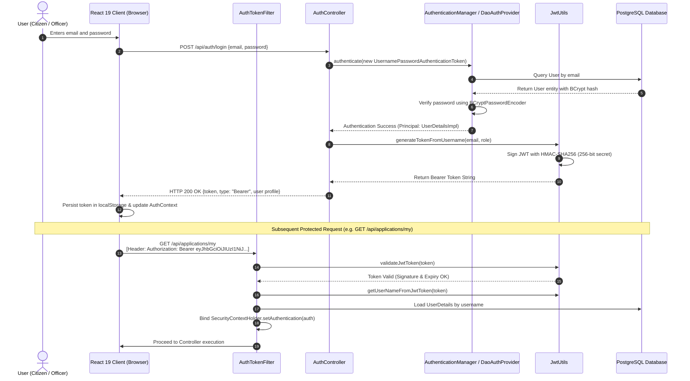
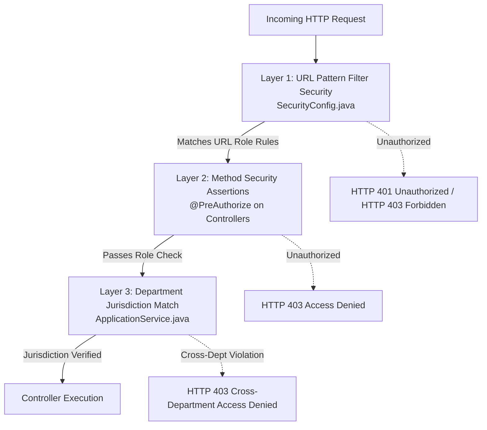
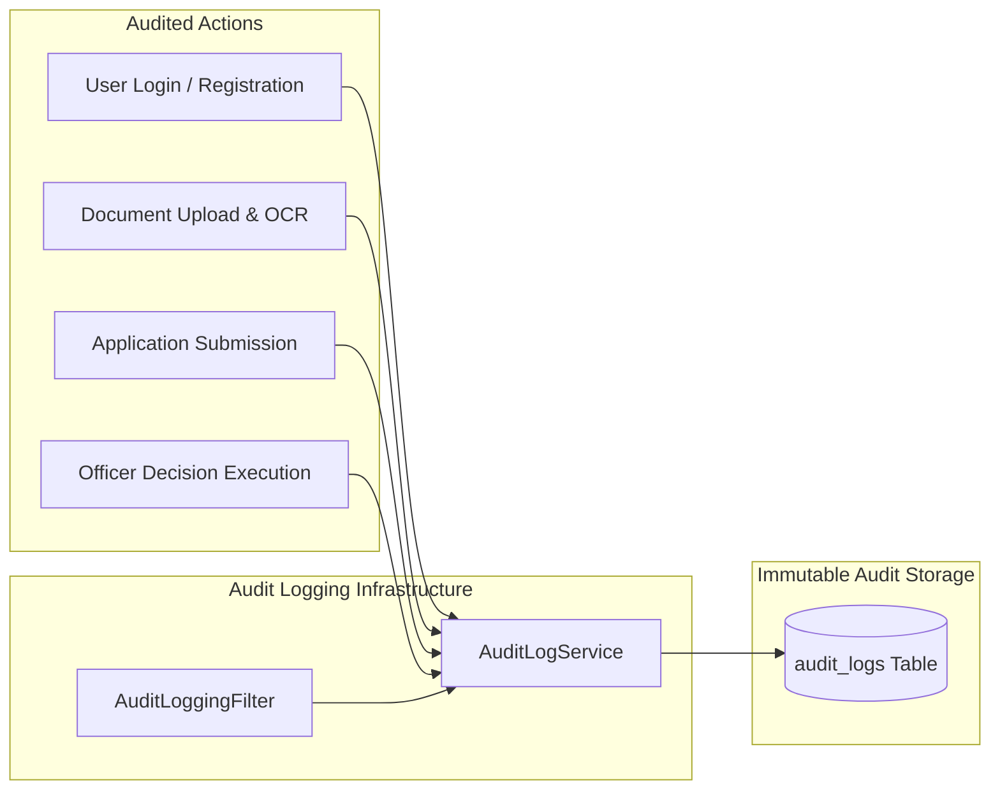

# 11. Security & Audit Architecture — Bhumisetu (भूमिसेतू)

> **Academic Year:** 2026–27  
> **Project Title:** Bhumisetu: AI-Enabled, GIS-Based Integrated Land Information & Single-Window Land Service Platform  
> **Tagline:** *"One Parcel. One Window."*  

---

## What This Document Covers

This document details the security architecture, cryptographic controls, authorization mechanisms, and audit systems implemented in Bhumisetu. It diagrams the stateless JWT authentication flow, explains BCrypt password hashing and role enforcement, details document access control and input sanitization, explains the immutable audit logging framework, and provides an honest review of prototype security limitations alongside concrete production-hardening steps.

---

## 1. Authentication Flow & JWT Architecture

Bhumisetu uses a completely **stateless token-based authentication** architecture powered by Spring Security 6 and JJWT (`io.jsonwebtoken:0.12.6`):



### JWT Token Claims Structure
* **Header:**
  ```json
  {
    "alg": "HS256",
    "typ": "JWT"
  }
  ```
* **Payload:**
  ```json
  {
    "sub": "planning@bhumisetu.in",
    "role": "ROLE_PLANNING_OFFICER",
    "iat": 1788288000,
    "exp": 1788374400
  }
  ```
* **Signature:** Created by computing the HMAC-SHA256 hash over the Base64Url-encoded header and payload using a 256-bit secret key.

---

## 2. Cryptographic Password Hashing (BCrypt)

User credentials are protected using the **BCrypt strong hashing function** (`org.springframework.security.crypto.bcrypt.BCryptPasswordEncoder`):

* **Work Factor (Cost Parameter):** Configured to `10`, representing $2^{10} = 1024$ key derivation rounds.
* **Automatic Salting:** BCrypt generates an internal 128-bit cryptographically secure random salt for every password before hashing. Even if two users choose the identical password (e.g., `Demo@123`), their stored hashes in the database are completely distinct.
* **Rainbow Table Immunity:** Precomputed hash lookups (rainbow tables) are completely ineffective due to dynamic salting.
* **Zero Plaintext Exposure:** Passwords are never serialized into DTOs, returned over the wire, or written to server logs. The `User.password` entity property is explicitly annotated with `@JsonIgnore`.

---

## 3. Multi-Layered RBAC & Departmental Boundary Enforcement

Bhumisetu enforces a **defense-in-depth** model spanning three tiers:



### 1. HTTP Pattern Matching Layer
Configured in [`SecurityConfig.java`](file:///backend/src/main/java/in/bhumisetu/security/SecurityConfig.java#L57-L75):
* Public whitelist: `/api/auth/**`, `/api/parcels/**`, `/api/search/**`, `/v3/api-docs/**`.
* Officer-restricted routes: `/api/applications/*/decision` and `/api/officer/**` require one of `ROLE_REVENUE_OFFICER`, `ROLE_PLANNING_OFFICER`, `ROLE_TREE_OFFICER`, `ROLE_UTILITY_OFFICER`, or `ROLE_ADMIN`.
* Admin routes: `/api/admin/**` requires `ROLE_ADMIN`.

### 2. Method-Level Security Assertions
Configured via `@EnableMethodSecurity`. Annotated on controller handlers:
```java
@PostMapping("/{id}/decision")
@PreAuthorize("hasAnyRole('PLANNING_OFFICER', 'REVENUE_OFFICER', 'UTILITY_OFFICER', 'TREE_OFFICER', 'ADMIN')")
public ResponseEntity<ApplicationDto> takeDecision(...) { ... }
```

### 3. Departmental Jurisdiction Guard
Even if an authenticated user possesses an officer role, they cannot approve applications outside their jurisdiction. Implemented in [`ApplicationService.java`](file:///backend/src/main/java/in/bhumisetu/service/ApplicationService.java#L191-L203):
```java
if (officer.getRole() != Role.ADMIN) {
    String officerDept = switch (officer.getRole()) {
        case PLANNING_OFFICER -> "PLANNING";
        case REVENUE_OFFICER -> "REVENUE";
        case UTILITY_OFFICER -> "UTILITY";
        case TREE_OFFICER -> "TREE";
        default -> "";
    };
    if (!application.getDepartment().getCode().equalsIgnoreCase(officerDept)) {
        throw new AccessDeniedException("Unauthorized: You belong to " + officerDept 
            + " and cannot act on " + application.getDepartment().getName() + " applications.");
    }
}
```

---

## 4. Document Access Control & Input Sanitization

1. **Storage Isolation:** Uploaded document scans are written to a dedicated disk directory (`/uploads` or `/app/uploads`) configured via application properties. They are stored outside the public application binary path, preventing remote code execution (RCE).
2. **UUID File Renaming:** To prevent path traversal attacks (`../`) and file overwrite vulnerabilities, original file names are prepended with random UUIDs (`UUID.randomUUID().toString() + "_" + originalFilename`).
3. **MIME Type Validation & Size Limits:** Multipart uploads are constrained to maximum 20MB (`spring.servlet.multipart.max-file-size: 20MB`), preventing denial-of-service memory exhaustion.
4. **Input Validation (Jakarta Bean Validation):** All incoming request DTOs are validated using annotations (`@NotNull`, `@NotBlank`, `@Size`, `@Email`):
   ```java
   public record LoginRequest(
       @NotBlank(message = "Email is required") @Email String email,
       @NotBlank(message = "Password is required") String password
   ) {}
   ```
5. **SQL Injection Prevention:** All database operations utilize Spring Data JPA parameterized queries and Criteria API. Dynamic string concatenation is strictly prohibited in SQL execution paths.

---

## 5. Immutable System Audit Logging

Accountability is maintained through an immutable audit trail captured in the `audit_logs` table:



### Log Schema Attributes:
* `user_id` & `user_email`: Identifies the authenticated actor.
* `action`: Standardized event string (e.g., `LOGIN_SUCCESS`, `DOCUMENT_OCR_DIGITIZED`, `OFFICER_DECISION`).
* `entity` & `entity_id`: Identifies the affected object (e.g., `Application: 1`).
* `ip_address`: Captured via `X-Forwarded-For` or client socket address.
* `details`: Explanatory context (e.g., `"Officer approved application under FSI 1.8"`).
* `timestamp`: System timestamp recorded at moment of execution.

---

## 6. Prototype Limitations & Production Hardening Roadmap

While the Bhumisetu prototype enforces rigorous enterprise patterns, production deployment in a state government environment requires further hardening:

| Security Domain | Prototype Implementation | Production Hardening Recommendation |
| :--- | :--- | :--- |
| **Secrets Management** | Stored in `application.yml` / Docker environment variables | Transition to **HashiCorp Vault** or **AWS Secrets Manager** with automatic secret rotation. |
| **Token Revocation** | Stateless JWT with 24-hour expiration | Implement a **Redis-backed token revocation list (blocklist)** and short-lived access tokens (15 mins) with refresh tokens. |
| **File Storage** | Local filesystem volume (`/uploads`) | Migrate to **S3-compatible Object Storage (MinIO / AWS S3)** with pre-signed ephemeral URLs and server-side encryption (SSE-KMS). |
| **Network Security** | HTTP over Docker bridge | Terminate **TLS 1.3 / HTTPS** at an API Gateway (Kong / Cloudflare) and enforce **Mutual TLS (mTLS)** internally. |
| **Rate Limiting** | Open API endpoints | Implement **Bucket4j / Redis Token Bucket rate limiting** (e.g., max 10 OCR uploads/min per IP) to mitigate DoS attacks. |
| **Legal Signatures** | Role-authenticated DB status update | Integrate **Aadhaar eSign / DSC (Digital Signature Certificate)** via licensed Certifying Authorities (eMudhra). |

---

## Key Takeaways

1. **Stateless JWT Security:** Employs HMAC-SHA256 signed tokens conveying identity and role claims, eliminating server session storage.
2. **Cryptographic Protection:** Protects user passwords using salted BCrypt with cost factor 10, preventing rainbow table attacks.
3. **Three-Tier Authorization:** Combines URL pattern matching, method-level `@PreAuthorize` assertions, and departmental code boundary validation.
4. **Secure File Handling:** Implements UUID-based file isolation outside execution roots with strict size constraints and MIME validation.
5. **Comprehensive Audit Trail:** Automatically captures immutable records of security actions, IP addresses, and workflow transitions in `audit_logs`.
