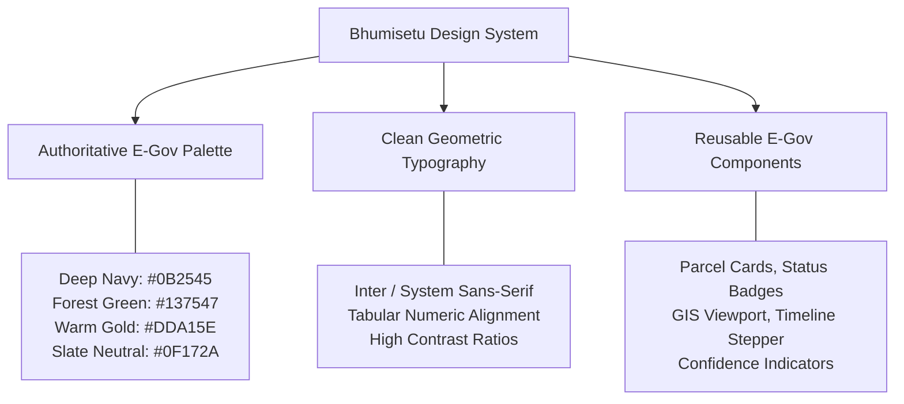
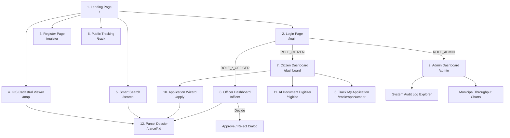

# 12. UI/UX & Design System Guide — Bhumisetu (भूमिसेतू)

> **Academic Year:** 2026–27  
> **Project Title:** Bhumisetu: AI-Enabled, GIS-Based Integrated Land Information & Single-Window Land Service Platform  
> **Tagline:** *"One Parcel. One Window."*  

---

## What This Document Covers

This document details the user interface design system, architectural layout, and user experience patterns implemented across the Bhumisetu frontend application. It outlines the core e-governance design system (color tokens, typography, component standards), provides an interactive sitemap and navigation flow diagram, inventories all twelve frontend views with role authorization constraints, and explains the rationale behind adopting a professional, high-trust public-sector visual identity.

---

## 1. E-Governance Design System

Government-to-Citizen (G2C) platforms require design systems that prioritize **high accessibility, authoritative trust, unambiguous typography, and high contrast**:

### 1.1 Color Palette Tokens

| Semantic Role | Color Name | Hex Code | Tailwind Token | Application & Visual Context |
| :--- | :--- | :--- | :--- | :--- |
| **Primary Brand** | Ashoka Deep Navy | `#0B2545` | `bg-[#0B2545]` | Primary navigation headers, hero banners, primary action buttons, authoritative badges. |
| **Secondary Brand** | Saffron Gold | `#DDA15E` | `bg-[#DDA15E]` | Accent borders, selected polygon highlights, call-to-action buttons, active tabs. |
| **Success / Sanction**| Forest Green | `#137547` | `bg-emerald-700` | Approved application status, high OCR confidence indicators, agricultural zoning. |
| **Warning / Scrutiny**| Amber Ochre | `#D97706` | `bg-amber-600` | `UNDER_REVIEW`, `INFO_REQUESTED` warnings, commercial zoning indicators. |
| **Danger / Rejection**| Crimson Red | `#DC2626` | `bg-red-600` | Rejected application notices, validation error text, access-denied modal banners. |
| **Background Neutral**| Slate White | `#F8FAFC` | `bg-slate-50` | Main application canvas background, reducing eye strain during extended casework. |
| **Surface Neutral** | Pure Card White | `#FFFFFF` | `bg-white` | Elevated card surfaces, modal dialogs, data tables, and dossier drawer panels. |
| **Text Primary** | Deep Charcoal | `#0F172A` | `text-slate-900` | High-contrast body typography complying with WCAG AAA accessibility contrast ratios. |

---

### 1.2 Typography & Hierarchy
* **Typeface Family:** Inter, system-ui, `-apple-system`, BlinkMacSystemFont, "Segoe UI", Roboto, sans-serif.
* **Heading 1 (`text-3xl font-extrabold text-[#0B2545]`):** Page titles and hero headers.
* **Heading 2 (`text-xl font-bold text-slate-800`):** Section titles (e.g., *"Ownership Chain"*, *"Cadastral Documents"*).
* **Heading 3 (`text-base font-semibold text-slate-700`):** Card titles and table column headers.
* **Body Text (`text-sm text-slate-600 leading-relaxed`):** Descriptive metadata and dossier attributes.
* **Tabular Figures (`font-mono tracking-tight`):** Applied to ULPINs, Survey numbers, Aadhaar masks, and GPS coordinates to ensure column alignment in data tables.

---

## 2. Sitemap & User Journey Flow Diagram

The diagram below maps all twelve frontend screens and their role-governed user navigation journeys:

---

## 3. Comprehensive Frontend Screen Catalog

| Screen Title | Route Path | Access / Role Required | Core Purpose & Interactive Capabilities |
| :--- | :--- | :--- | :--- |
| **Landing Page** | `/` | Public (All) | Platform introduction, key statistics (parcels registered, applications sanctioned), single-window value proposition, and quick links to map and search. |
| **Login Page** | `/login` | Public (All) | Authenticates credentials; features 1-click demo login buttons for all six roles to accelerate evaluation and testing. |
| **Register Page** | `/register` | Public (All) | Enables citizens to register accounts with full name, email, phone, and password. |
| **GIS Cadastral Map** | `/map` | Public (All) | Full-screen interactive Leaflet map rendering all 25 Pune cadastral parcel polygons color-coded by land use with click-to-preview tooltips. |
| **Parcel Dossier** | `/parcel/:id` | Public (All) | 360-degree legal dossier aggregating spatial attributes, ownership records, verified 7/12 extracts, and historical applications. |
| **AI Document Page**| `/digitize` | Authenticated | Drag-and-drop document upload interface; triggers Tesseract OCR, displays extracted fields with confidence scores, and enables review & verify. |
| **Smart Search** | `/search` | Public (All) | Multi-faceted search engine querying across parcel survey numbers, ULPINs, and OCR full-text extracts with snippet highlighting. |
| **Application Wizard**| `/apply` | `CITIZEN`, `ADMIN` | Multi-step submission form for Building Permission, NA Conversion, or Water Connection, linking parcel ID and uploaded attachments. |
| **Application Tracking**| `/track` `/track/:appNumber` | Public (All) | Visual timeline tracker displaying current application status, assigned department officer, and chronological decision remarks. |
| **Citizen Dashboard** | `/dashboard` | `CITIZEN`, `ADMIN` | Citizen personal hub displaying active applications, draft submissions, bookmarked parcels, and recent status notifications. |
| **Officer Dashboard** | `/officer` | Department Officers & `ADMIN` | Departmental review queue; enables officers to inspect pending files, review dossiers, and execute Approve / Reject / Info-Requested actions. |
| **Admin Dashboard** | `/admin` | `ADMIN` only | Executive municipal analytics with Recharts graphs (service breakdown, SLA throughput, approval rates), user directory, and immutable audit logs. |

---

## 4. Rationale for the Public-Sector E-Governance Look

In commercial e-commerce or entertainment applications, web design emphasizes bright neon gradients, decorative micro-interactions, and heavy parallax animations. In public-sector land governance, such styling undermines institutional credibility and distracts from high-stakes legal scrutiny.

### Key UX Principles Adopted:
1. **Institutional Trust & Authority:** The use of national civic colors (Ashoka Deep Navy, warm saffron gold, and forest green) evokes the seriousness of municipal governance.
2. **Predictable Layouts:** Fixed top navigation, clear breadcrumbs, and standardized table headers ensure citizens of varying digital literacy can navigate without confusion.
3. **Information Density over White Space:** Officers reviewing hundreds of municipal files daily need compact tables with high visual information density, sorting controls, and status pills rather than oversized cards.
4. **WCAG Accessibility Compliance:** High-contrast text colors (`#0F172A` on `#FFFFFF` and `#F8FAFC`) ensure readability for visually impaired users and field officers on outdoor mobile screens.

---

## Key Takeaways

1. **Curated E-Gov Design System:** Utilizes an authoritative color palette (Deep Navy, Warm Gold, Forest Green) with clean Inter typography and tabular numeric figures.
2. **Twelve Integrated Views:** Spans public discovery (Map, Search, Dossier, Tracking), citizen self-service (Apply, Digitize, Dashboard), officer casework (Queue, Decision), and executive governance (Admin).
3. **Role-Enforced Navigation:** Dynamic navigation links adapt based on authenticated credentials, hiding administrative links from citizens.
4. **Direct Map-to-Action Flows:** Citizens can seamlessly jump from a clicked map polygon into the application wizard or legal dossier with a single click.
5. **High-Density Usability:** Balances modern responsive design with compact, readable data tables optimized for municipal casework workflows.
