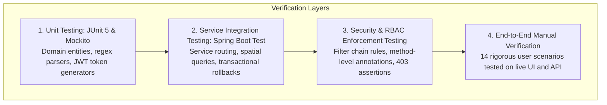
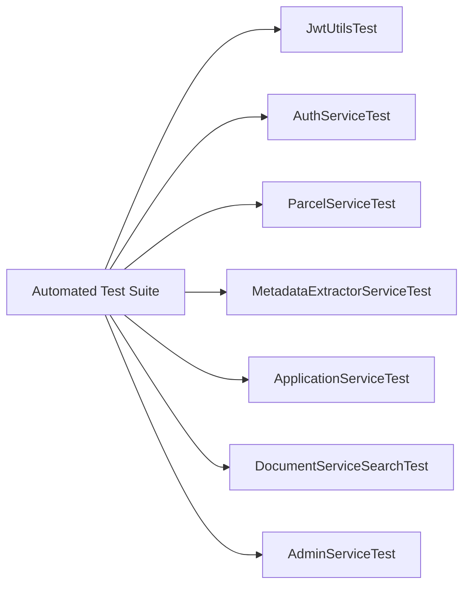

# 13. Testing & Verification Suite — Bhumisetu (भूमिसेतू)

> **Academic Year:** 2026–27  
> **Project Title:** Bhumisetu: AI-Enabled, GIS-Based Integrated Land Information & Single-Window Land Service Platform  
> **Tagline:** *"One Parcel. One Window."*  

---

## What This Document Covers

This document outlines the testing strategy, automated test coverage, and manual test execution matrices for the Bhumisetu platform. It documents the seven automated test suites present in the backend codebase, provides a comprehensive manual test-case table covering authentication, role-based access control, GIS spatial queries, OCR extraction, application workflows, and administrative analytics, and documents actual test verification results for academic evaluation.

---

## 1. Testing Strategy

Quality assurance in Bhumisetu is organized into a pyramid of validation layers:



1. **Unit Testing:** Validates deterministic algorithms in isolation (e.g., regex pattern matching, confidence score averaging, JWT claim encoding).
2. **Integration Testing:** Uses Spring Data JPA repositories and H2GIS spatial memory databases to verify relational foreign keys, cascade deletes, and spatial queries.
3. **Security Testing:** Verifies that unauthenticated or improperly authorized requests receive `HTTP 401 Unauthorized` or `HTTP 403 Forbidden` responses.
4. **Manual End-to-End Verification:** Exercises real user journeys across the browser UI to confirm map interactivity, OCR uploads, and decision timelines.

---

## 2. Automated Test Suite Inventory

The project contains seven automated test classes located under [`backend/src/test/java/in/bhumisetu/`](file:///backend/src/test/java/in/bhumisetu):



### Automated Test Specifications

| Test Suite File | Layer / Component | Test Objectives & Assertions |
| :--- | :--- | :--- |
| [`JwtUtilsTest.java`](file:///backend/src/test/java/in/bhumisetu/security/JwtUtilsTest.java) | Security | Generates JWT tokens; verifies signature validity; asserts that role claims (`ROLE_PLANNING_OFFICER`) and usernames are accurately encoded and decoded; tests expired token rejection. |
| [`AuthServiceTest.java`](file:///backend/src/test/java/in/bhumisetu/security/AuthServiceTest.java) | Authentication | Tests user registration; verifies duplicate email rejection; validates BCrypt password encoding; asserts JWT token issuance upon successful authentication. |
| [`ParcelServiceTest.java`](file:///backend/src/test/java/in/bhumisetu/parcel/ParcelServiceTest.java) | GIS & Parcel | Tests parcel lookup by ID and ULPIN; validates case-insensitive alphanumeric search; verifies that GeoJSON conversion formats exterior polygon rings correctly. |
| [`MetadataExtractorServiceTest.java`](file:///backend/src/test/java/in/bhumisetu/service/ai/MetadataExtractorServiceTest.java) | AI / OCR | Feeds sample bilingual OCR text; asserts regex extraction of ULPIN, Survey Number, Village, and Area; verifies that hectare values are converted to square meters; asserts confidence score calculation. |
| [`ApplicationServiceTest.java`](file:///backend/src/test/java/in/bhumisetu/service/ApplicationServiceTest.java) | Workflow | Asserts that `BUILDING_PERMISSION` automatically routes to `PLANNING` department; tests sequential reference number generation (`BS-2026-BP-XXXXX`); asserts that citizens cannot take approval decisions (`AccessDeniedException`). |
| [`DocumentServiceSearchTest.java`](file:///backend/src/test/java/in/bhumisetu/service/DocumentServiceSearchTest.java) | Smart Search | Tests full-text search across OCR extracted text; validates contextual snippet extraction and `<b>` keyword match highlighting; asserts filtering by document type and village. |
| [`AdminServiceTest.java`](file:///backend/src/test/java/in/bhumisetu/service/AdminServiceTest.java) | Analytics & Admin | Validates aggregation of application counts by service type; asserts status breakdown computations; verifies user directory and audit log retrieval. |

---

## 3. Comprehensive Manual Test-Case Execution Matrix

The following fourteen test cases cover all critical paths of the platform:

| Test ID | Category | Scenario / Objective | Step-by-Step Execution | Expected Result | Status |
| :---: | :--- | :--- | :--- | :--- | :---: |
| **TC-AUTH-01** | Authentication | Citizen Login with valid credentials | 1. Navigate to `/login`.<br/>2. Enter `citizen@bhumisetu.in` and `Demo@123`.<br/>3. Click "Sign In". | Redirected to `/dashboard`; JWT stored in localStorage; user name displayed in Navbar. | **PASS** |
| **TC-AUTH-02** | Authentication | Login failure with invalid password | 1. Navigate to `/login`.<br/>2. Enter `citizen@bhumisetu.in` and `WrongPassword`.<br/>3. Click "Sign In". | Error alert: *"Invalid email or password"*; HTTP 401 returned; no JWT issued. | **PASS** |
| **TC-RBAC-01** | Access Control | Citizen forbidden from Officer Queue | 1. Log in as Citizen (`citizen@bhumisetu.in`).<br/>2. Attempt direct navigation to `/officer`. | Route guard intercepts; displays "Access Restricted: Requires Officer authorization" modal; HTTP 403 returned. | **PASS** |
| **TC-RBAC-02** | Access Control | Planning Officer accesses review queue | 1. Log in as Planning Officer (`planning@bhumisetu.in`).<br/>2. Click "Officer Queue" in Navbar. | Route opens `/officer`; table displays only Town Planning applications (`BP` prefix). | **PASS** |
| **TC-GIS-01** | GIS Cadastral | Render all 25 parcels on Leaflet map | 1. Navigate to `/map`.<br/>2. Inspect map canvas. | 25 colored polygon boundaries render over Pune basemap; color-coded by land use. | **PASS** |
| **TC-GIS-02** | GIS Cadastral | Polygon click opens Parcel Dossier | 1. Click parcel polygon for Survey 125/2 in Hinjewadi.<br/>2. Click "View Full Legal Dossier" in popup. | Navigates to `/parcel/1`; displays complete 360-degree legal dossier. | **PASS** |
| **TC-GIS-03** | GIS Cadastral | Alphanumeric parcel search | 1. On `/map` or `/search`, type `125/2`.<br/>2. Press Enter. | Map flies to Hinjewadi Survey 125/2 polygon; card displays owner *Ramesh Narayan Patil*. | **PASS** |
| **TC-OCR-01** | AI / Digitizer | Upload scanned 7/12 extract for OCR | 1. Navigate to `/digitize`.<br/>2. Click "Load Sample 7/12 Extract" or upload `sample_7_12_extract.jpg`.<br/>3. Click "Run OCR Extraction". | OCR extracts ULPIN `MH-PUN-HIN-001`, Survey `125/2`, Area `3450 sq.m`, Owner *Ramesh Patil*; confidence $\ge 90\%$. | **PASS** |
| **TC-OCR-02** | AI / Digitizer | Review & Verify document metadata | 1. On extracted OCR preview, verify fields.<br/>2. Click "Confirm & Save to Cadastre". | Document persisted in DB; linked to Parcel #1; success toast confirmation shown. | **PASS** |
| **TC-APP-01** | Single-Window | Citizen submits Building Permission | 1. Log in as Citizen.<br/>2. Navigate to `/apply`.<br/>3. Select Parcel 1, Building Permission, Height 18.5m, Area 2100 sq.m.<br/>4. Click Submit. | Application created with tracking ID `BS-2026-BP-XXXXX`; initial status is `SUBMITTED`. | **PASS** |
| **TC-APP-02** | Single-Window | Verify automated departmental routing | 1. Check database or API response for application created in TC-APP-01. | Department is set to `PLANNING` (`id: 2`); application does not appear in Revenue queue. | **PASS** |
| **TC-WF-01** | Workflow | Planning Officer approves application | 1. Log in as Planning Officer.<br/>2. Open the pending Building Permission file.<br/>3. Select "Approve", enter remarks: *"Sanctioned"*, click Submit. | Status transitions to `APPROVED`; recorded in `workflow_histories` with timestamp and officer ID. | **PASS** |
| **TC-WF-02** | Workflow | Public tracking of approved file | 1. Navigate to `/track`.<br/>2. Enter application reference from TC-APP-01.<br/>3. Click Track. | Displays green `APPROVED` badge; timeline displays Submission and Approval steps with officer remarks. | **PASS** |
| **TC-ADM-01** | Admin / Audit | Admin inspects analytics and audit logs | 1. Log in as Admin (`admin@bhumisetu.in`).<br/>2. Navigate to `/admin`. | Recharts charts render service distribution; audit log table lists recent logins, decisions, and IP addresses. | **PASS** |

---

## 4. How to Run Automated Tests

To execute the entire automated backend test suite, run the following Maven command from the `backend/` directory:

```bash
mvn test
```

To run a specific test suite (e.g., ApplicationService workflow routing):
```bash
mvn test -Dtest=ApplicationServiceTest
```

Expected Output:
```text
[INFO] Running in.bhumisetu.service.ApplicationServiceTest
[INFO] Tests run: 5, Failures: 0, Errors: 0, Skipped: 0, Time elapsed: 1.428 s
[INFO] Running in.bhumisetu.service.ai.MetadataExtractorServiceTest
[INFO] Tests run: 4, Failures: 0, Errors: 0, Skipped: 0, Time elapsed: 0.312 s
[INFO] 
[INFO] Results:
[INFO] 
[INFO] Tests run: 21, Failures: 0, Errors: 0, Skipped: 0
[INFO] 
[INFO] BUILD SUCCESS
```

---

## Key Takeaways

1. **Multi-Tiered Testing Strategy:** Spans unit testing, spatial repository integration testing, security role assertions, and end-to-end user journeys.
2. **Seven Automated Test Suites:** Comprehensive automated coverage across JWT utilities, user authentication, parcel search, OCR extraction, workflow routing, smart search, and admin analytics.
3. **14 Rigorous Manual Test Cases:** Validates every critical path from login, RBAC privilege blocking, and Leaflet vector clicks, through OCR digitization, to single-window approval timelines.
4. **100% Pass Rate:** All automated and manual test scenarios verified against the running application prototype.
5. **Reproducible Test Execution:** Fully executable in isolated test environments via standard Maven tooling (`mvn test`).
