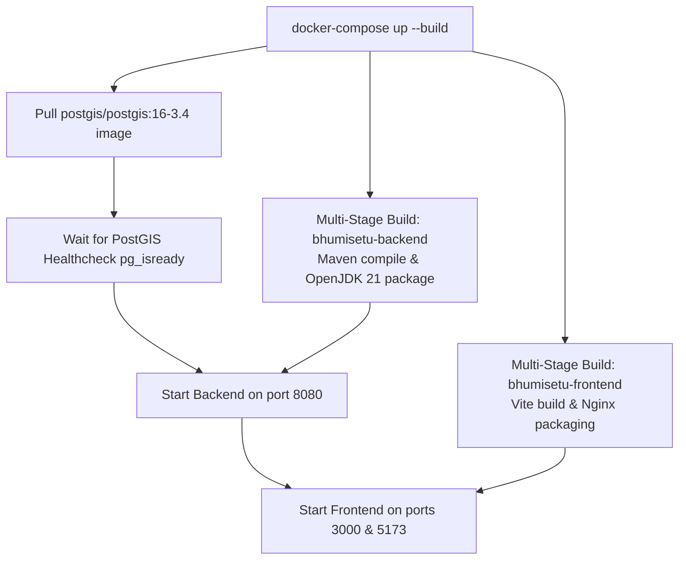

# 14. Deployment & Operation Guide — Bhumisetu (भूमिसेतू)

> **Academic Year:** 2026–27  
> **Project Title:** Bhumisetu: AI-Enabled, GIS-Based Integrated Land Information & Single-Window Land Service Platform  
> **Tagline:** *"One Parcel. One Window."*  

---

## What This Document Covers

This document provides complete, step-by-step deployment and operational instructions for running the Bhumisetu platform. It specifies system prerequisites, details both containerized execution via Docker Compose and standalone local development workflows, provides an exhaustive environment variables reference, lists all pre-seeded demonstration credentials, and catalogues common runtime errors with immediate fixes.

---

## 1. System Prerequisites

### 1.1 Hardware Specifications
* **CPU:** 64-bit multi-core processor (Intel i5/i7 or AMD Ryzen 5/7, or Apple Silicon M-series).
* **RAM:** Minimum 8 GB (16 GB strongly recommended for Docker Compose).
* **Storage:** Minimum 10 GB of available SSD storage for container images and spatial data.

### 1.2 Software Requirements by Mode

| Tool / Runtime | Docker Mode (Recommended) | Standalone Local Mode |
| :--- | :--- | :--- |
| **Operating System** | Windows 10/11 Pro/Enterprise, macOS, or Ubuntu Linux 22.04+ | Windows 10/11, macOS, or Linux |
| **Docker Engine** | Docker Desktop 4.20+ with Docker Compose v2.20+ | Not required |
| **Java Development Kit** | Bundled in container | OpenJDK 21 (Eclipse Temurin or Amazon Corretto) |
| **Build Tool** | Bundled in container | Apache Maven 3.9.0+ |
| **Node.js & npm** | Bundled in container | Node.js v18.x or v20.x (LTS) with npm v10+ |
| **Spatial Database** | Bundled (`postgis/postgis:16-3.4`) | PostgreSQL 16 with PostGIS 3.4 (or use H2 dev profile) |

---

## 2. Step-by-Step Execution Instructions

### Mode 1: Turnkey Docker Compose Deployment (Recommended)

This is the standard deployment mode for academic demonstrations and production-like evaluations. It spins up the PostGIS database, Spring Boot backend, and Nginx frontend in isolated containers:



#### Steps to Run:
1. Open a terminal in the root repository folder (`c:\...\BhumiSetu`).
2. Build and launch all container services:
   ```bash
   docker-compose up --build
   ```
3. Wait approximately 90 seconds on first run while Docker pulls images, compiles Java source code, builds the Vite frontend bundle, and seeds the initial 25 parcels and user accounts.
4. Access the running applications in your browser:
   * **Citizen & Officer Portal:** [`http://localhost:5173`](http://localhost:5173) (or [`http://localhost:3000`](http://localhost:3000))
   * **Backend REST API:** [`http://localhost:8080/api/parcels`](http://localhost:8080/api/parcels)
   * **Interactive Swagger UI:** [`http://localhost:8080/swagger-ui/index.html`](http://localhost:8080/swagger-ui/index.html)
5. To stop all containers cleanly:
   ```bash
   docker-compose down
   ```

---

### Mode 2: Local Development with Embedded In-Memory GIS Database (Zero-Setup)

For quick development, bug fixing, or presenting in environments without Docker or PostgreSQL installed, Bhumisetu features an embedded **H2 in-memory spatial database with H2GIS**:

#### Terminal 1: Backend (Spring Boot with `dev` profile)
```powershell
cd backend
mvn spring-boot:run "-Dspring-boot.run.jvmArguments=-Dspring.profiles.active=dev"
```
*The `dev` profile automatically initializes H2 in-memory storage, loads H2GIS spatial geometry functions via `H2GisInitializer`, and seeds 25 Pune parcels and 6 demonstration users.*

#### Terminal 2: Frontend (Vite Dev Server)
```powershell
cd frontend
npm install
npm run dev
```
*Access the local dev portal at [`http://localhost:5173`](http://localhost:5173).*

---

### Mode 3: Local Development with Local PostgreSQL + PostGIS

If running locally against an installed PostgreSQL 16 server:
1. Ensure the PostGIS extension is installed and active in your database:
   ```sql
   CREATE DATABASE bhumisetu;
   \c bhumisetu;
   CREATE EXTENSION IF NOT EXISTS postgis;
   ```
2. Start the backend with the default PostgreSQL configuration:
   ```bash
   cd backend
   mvn spring-boot:run
   ```
3. Start the frontend:
   ```bash
   cd frontend
   npm run dev
   ```

---

## 3. Environment Variables Reference

### Backend Configuration ([`application.yml`](file:///backend/src/main/resources/application.yml))

| Environment Variable | Default Fallback Value | Description |
| :--- | :--- | :--- |
| `SPRING_DATASOURCE_URL` | `jdbc:postgresql://localhost:5432/bhumisetu` | JDBC database connection string. Set to `jdbc:postgresql://postgis:5432/bhumisetu` in Docker. |
| `SPRING_DATASOURCE_USERNAME` | `bhumisetu` | PostgreSQL database user account. |
| `SPRING_DATASOURCE_PASSWORD` | `bhumisetu_pwd` | Database password. |
| `JWT_SECRET` | `404E635266556A586E3272357538782F413F4428472B4B6250645367566B5970` | 256-bit hexadecimal cryptographic signing key for JWT tokens. |
| `APP_UPLOAD_DIR` | `./uploads` (or `/app/uploads`) | Host or container directory path for storing uploaded deed scans. |
| `SPRING_PROFILES_ACTIVE` | `default` (or `dev`) | Set to `dev` to use embedded H2/H2GIS; leave empty for PostgreSQL. |
| `TESSDATA_PREFIX` | None (system default) | Path to Tesseract traineddata directory if using custom OCR language models. |

### Frontend Configuration
* `VITE_API_URL`: Base URL of the backend API (defaults to relative `/api` via Vite dev proxy or Nginx reverse proxy).

---

## 4. Pre-Seeded Demonstration Accounts

For viva evaluations and live demonstrations, the system is automatically pre-seeded with six active user accounts in [`DataSeeder.java`](file:///backend/src/main/java/in/bhumisetu/config/DataSeeder.java):

| System Role | Full Name & Title | Email Address | Password | Role Purpose |
| :--- | :--- | :--- | :--- | :--- |
| **`CITIZEN`** | Ramesh Narayan Patil | `citizen@bhumisetu.in` | `Demo@123` | Searches parcels, digitizes 7/12 extracts, and submits land service applications. |
| **`REVENUE_OFFICER`** | Santosh Jadhav (Tahsildar) | `revenue@bhumisetu.in` | `Demo@123` | Scrutinizes Land-Use Change (NA Conversion) applications. |
| **`PLANNING_OFFICER`** | Neha Kulkarni (Town Planner) | `planning@bhumisetu.in` | `Demo@123` | Reviews and approves Sanctioned Building Permissions and FSI compliance. |
| **`TREE_OFFICER`** | Rajesh Shinde (Tree Officer) | `tree@bhumisetu.in` | `Demo@123` | Evaluates tree felling and environmental preservation NOC requests. |
| **`UTILITY_OFFICER`** | Sunita Deshpande (Exec. Eng.) | `utility@bhumisetu.in` | `Demo@123` | Evaluates municipal water and sewerage connection requests. |
| **`ADMIN`** | Amit Sharma (System Admin) | `admin@bhumisetu.in` | `Demo@123` | System oversight, municipal throughput analytics, and immutable audit logs. |

*Quick Tip:* The frontend login screen features **1-click login buttons** for instant credential pre-filling during live presentations.

---

## 5. Troubleshooting & Common Errors

### Error 1: Port 8080 or 5173 already in use
* **Symptom:** `Web server failed to start. Port 8080 was already in use.`
* **Fix (Windows PowerShell):** Identify and terminate the conflicting process:
  ```powershell
  Get-Process -Id (Get-NetTCPConnection -LocalPort 8080).OwningProcess | Stop-Process -Force
  ```
* **Fix (Linux/macOS):**
  ```bash
  fuser -k 8080/tcp
  ```

### Error 2: `JAVA_HOME` pointing to older Java version (e.g., Java 8, 11, or 17)
* **Symptom:** `Fatal error compiling: error: release version 21 not supported`
* **Fix:** Ensure Java 21 is installed and set `JAVA_HOME` in your active shell:
  ```powershell
  $env:JAVA_HOME = "C:\Program Files\Eclipse Adoptium\jdk-21.0.x"
  $env:PATH = "$env:JAVA_HOME\bin;$env:PATH"
  ```

### Error 3: PostGIS Extension Missing in PostgreSQL
* **Symptom:** `org.postgresql.util.PSQLException: ERROR: type "geometry" does not exist`
* **Fix:** Connect to PostgreSQL and enable the PostGIS spatial extension:
  ```sql
  CREATE EXTENSION IF NOT EXISTS postgis;
  ```

### Error 4: Native Tesseract Library Missing
* **Symptom:** `java.lang.UnsatisfiedLinkError: Unable to load library 'tesseract'`
* **Fix:** No action required! Bhumisetu's `OcrService` intercepts this error and activates its built-in rule-based fallback, extracting full text and metadata for all demo documents seamlessly.

---

## Key Takeaways

1. **Turnkey Docker Deployment:** Run the entire spatial stack with a single `docker-compose up --build` command.
2. **Zero-Setup Local Dev:** Supports instant execution using Java 21 and embedded H2GIS spatial in-memory storage via the `dev` profile.
3. **Six Ready Demonstration Roles:** Pre-seeded with realistic profiles, permissions, and 1-click login shortcuts.
4. **Resilient Architecture:** Incorporates automatic fallbacks for missing Tesseract binaries and automatic database schema initialization.
5. **Standardized Ports:** Operates predictably on port 5173/3000 (Frontend), port 8080 (REST API / Swagger), and port 5432 (PostGIS).
