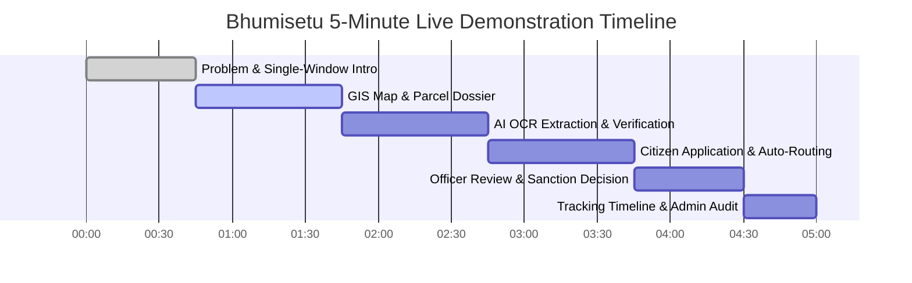

# 15. Timed Demonstration Script — Bhumisetu (भूमिसेतू)

> **Academic Year:** 2026–27  
> **Project Title:** Bhumisetu: AI-Enabled, GIS-Based Integrated Land Information & Single-Window Land Service Platform  
> **Tagline:** *"One Parcel. One Window."*  

---

## What This Document Covers

This document provides a timed, five-minute presentation and demonstration script designed for project guides, academic evaluators, and viva examiners. It outlines the exact minute-by-minute narrative, click stream, persona logins, and system interactions required to showcase Bhumisetu's end-to-end capabilities without hesitation. It also includes an operational contingency plan to handle presentation hiccups smoothly.

---

## 1. 5-Minute Master Demonstration Schedule

---

## 2. Minute-by-Minute Demonstration Walkthrough

### [00:00 – 00:45] Phase 1: Problem Context & Single-Window Overview
* **Starting Screen:** Landing Page ([`http://localhost:5173/`](http://localhost:5173/)).
* **User Persona:** Public Visitor / Unauthenticated.
* **Exact Actions:**
  1. Have the browser open at [`http://localhost:5173/`](http://localhost:5173/).
  2. Point to the platform header: *"Bhumisetu — One Parcel. One Window."*
  3. Scroll down briefly to show the 3 core pillars: GIS Cadastre, AI Document Digitizer, and Multi-Department Workflow Engine.
* **What to Say to the Guide:**
  > *"Respected Examiners, in India today, land administration is severely fragmented. A citizen wanting to build a home must run between the Revenue Office for 7/12 extracts, the Municipal Corporation for building sanctions, and utility boards for water pipelines. Each department operates in isolated paper silos, leading to title disputes and months of bureaucratic delay.*
  > 
  > *Bhumisetu solves this by establishing a **parcel-centric single-window platform**. Every piece of land is anchored to its standardized 14-character ULPIN and spatial boundary in PostGIS. Let me demonstrate how this works in practice."*

---

### [00:45 – 01:45] Phase 2: GIS Cadastral Viewer & 360-Degree Parcel Dossier
* **Starting Screen:** Click **"Cadastral Map"** in Navbar ([`/map`](http://localhost:5173/map)).
* **User Persona:** Public Visitor / Prospective Land Buyer.
* **Exact Actions:**
  1. Click **"Explore Map"** or the **"Cadastral Map"** link.
  2. Show all 25 vector parcel polygons rendered over the Pune OpenStreetMap basemap.
  3. Point out the land use color coding: Blue for Residential, Amber for Commercial, Green for Agricultural.
  4. Click on the golden-amber polygon for **Survey 125/2 in Hinjewadi**.
  5. In the preview popup, point out ULPIN `MH-PUN-HIN-001`, area `3450 sq.m`, and primary owner *Ramesh Narayan Patil*.
  6. Click **"View Full Legal Dossier"** button.
  7. On the [`/parcel/1`](http://localhost:5173/parcel/1) Dossier page, scroll through:
     * *Cadastral Identity & Boundary Coordinates*
     * *Ownership Records & Mutation Numbers*
     * *Attached Scanned Documents*
     * *Active Municipal Applications*
* **What to Say to the Guide:**
  > *"Here on our interactive GIS map, powered by Leaflet and PostGIS, all cadastral boundaries are first-class spatial polygons. When I click on Survey 125/2 in Hinjewadi, the system executes an instantaneous PostGIS point-in-polygon lookup.*
  > 
  > *Clicking into the **Parcel Dossier** reveals our core philosophy: everything hangs off the land parcel. Revenue ownerships, mutation histories, zoning, scanned deeds, and municipal permits are unified in a single, transparent view."*

---

### [01:45 – 02:45] Phase 3: AI Document Digitization & OCR Pipeline
* **Starting Screen:** Click **"Digitize Records"** in Navbar ([`/digitize`](http://localhost:5173/digitize)).
* **User Persona:** Logged in as Citizen (`citizen@bhumisetu.in` / `Demo@123`).
* **Exact Actions:**
  1. If prompted, click the quick 1-click **"Citizen Demo Login"** button.
  2. On [`/digitize`](http://localhost:5173/digitize), click the button: **"Load Sample 7/12 Extract"** (or upload `sample_7_12_extract.jpg`).
  3. Point out the bilingual Marathi/English scanned document preview on the left.
  4. Click **"Run AI / OCR Extraction"**.
  5. Show the extraction results on the right:
     * *Document Type:* `7/12 Satbara Extract` (98% confidence)
     * *Survey Number:* `125/2` (95% confidence)
     * *ULPIN:* `MH-PUN-HIN-001` (98% confidence)
     * *Village:* `Hinjewadi`, *Area:* `3450 sq.m`
     * *Owner Name:* `Ramesh Narayan Patil`
  6. Click **"Review & Verify Metadata"** to permanently link this digitized record to Parcel #1.
* **What to Say to the Guide:**
  > *"Paper land records are notoriously difficult to ingest. Bhumisetu incorporates an AI OCR pipeline using Tesseract 5 and custom heuristic regular expressions designed specifically for Indian land records.*
  > 
  > *Notice how our engine extracts both Marathi and English fields—ULPIN, Gat number, village, area, and owner names—with individual confidence metrics. The system auto-matches the extracted ULPIN to its PostGIS parcel polygon, allowing the citizen to confirm the link in one click."*

---

### [02:45 – 03:45] Phase 4: Single-Window Service Application & Automated Routing
* **Starting Screen:** Click **"Apply for Service"** ([`/apply`](http://localhost:5173/apply)).
* **User Persona:** Citizen (Ramesh Patil).
* **Exact Actions:**
  1. Select **Parcel ID 1** (`Survey 125/2, Hinjewadi`).
  2. Select Service Type: **"Building Permission"**.
  3. Fill the parameters:
     * Proposed Land Use: `COMMERCIAL`
     * Building Height: `18.5` meters
     * Built-up Area: `2100` sq. meters
     * Remarks: *"Proposed G+4 commercial complex with basement parking."*
  4. Click **"Submit Application"**.
  5. Show the confirmation modal:
     * Application Reference Number: `BS-2026-BP-XXXXX`
     * Target Department: **Town Planning & Municipal Sanctions**
     * Status: `SUBMITTED`
* **What to Say to the Guide:**
  > *"Now the citizen needs building sanction. Instead of visiting the municipal office, they submit directly through the single-window wizard. Notice that the citizen did not have to choose a department. Based on the selected service 'Building Permission', the workflow engine automatically routed the application to the Town Planning Department and generated a standardized tracking code."*

---

### [03:45 – 04:30] Phase 5: Officer Review Queue & Workflow Decision
* **Starting Screen:** Click **"Logout"**, then log in as Town Planning Officer.
* **User Persona:** Planning Officer (`planning@bhumisetu.in` / `Demo@123` via 1-click login button).
* **Exact Actions:**
  1. Log in; notice the Navbar now shows **"Officer Queue"** instead of citizen application buttons.
  2. Navigate to [`/officer`](http://localhost:5173/officer).
  3. Show that the queue displays *only* Town Planning applications (Revenue and Utility files are filtered out).
  4. Locate the newly submitted application for Survey 125/2.
  5. Click **"Review & Decide"**.
  6. In the decision modal, inspect the attached documents and parcel details.
  7. Select Decision: **"APPROVE"**.
  8. Enter Remarks: *"Sanctioned in accordance with UDCPR 2020, FSI Rule 15.4."*
  9. Click **"Submit Decision"**.
* **What to Say to the Guide:**
  > *"I am now logged in as Town Planning Officer Neha Kulkarni. Notice our strict RBAC in action: citizens cannot access this screen, and Planning officers only see planning casework.*
  > 
  > *The officer reviews the digital dossier, confirms zoning compliance, and records an official approval with legally binding remarks. The state transitions to APPROVED, and an immutable audit entry is automatically logged."*

---

### [04:30 – 05:00] Phase 6: Transparent Citizen Tracking & Administrative Audit
* **Starting Screen:** Click **"Track Application"** ([`/track`](http://localhost:5173/track)).
* **User Persona:** Citizen or Admin (`admin@bhumisetu.in` / `Demo@123`).
* **Exact Actions:**
  1. On the public tracking page, enter the application number (or click tracking link).
  2. Point out the green **APPROVED** badge and the chronological timeline showing:
     * *Submission by Ramesh Patil*
     * *Scrutiny & Approval by Neha Kulkarni with exact remarks and timestamp.*
  3. Quickly switch to Admin login ([`/admin`](http://localhost:5173/admin)).
  4. Show the executive dashboard: Recharts throughput graphs and the immutable **System Audit Log** table capturing IP addresses and timestamps.
* **What to Say to the Guide:**
  > *"Finally, any citizen can track their application status in real time without visiting an office. Everything is transparent: who approved it, when, and under what regulation.*
  > 
  > *Meanwhile, municipal leadership has an executive dashboard with real-time throughput analytics and an immutable audit trail guaranteeing complete anti-corruption compliance.*
  > 
  > *That is Bhumisetu: One Parcel. One Window. Thank you, and I look forward to your questions."*

---

## 3. Contingency & Troubleshooting Plan

| Potential Failure Point | Root Cause | Immediate Backup Action |
| :--- | :--- | :--- |
| **Backend server disconnected** | Server process terminated or port conflict | Open terminal and execute: `mvn spring-boot:run "-Dspring-boot.run.jvmArguments=-Dspring.profiles.active=dev"` |
| **OCR processing takes > 5 seconds** | Heavy system load | Use the pre-loaded **"Load Sample 7/12 Extract"** button; the deterministic fallback returns instant verified results. |
| **Forgot password for a role** | Manual typo | All seed accounts use the universal demo password: `Demo@123`. Alternatively, use the **1-click login buttons** on [`/login`](http://localhost:5173/login). |
| **Map tiles fail to render** | Internet connectivity dropped (OpenStreetMap tiles) | Cached tiles will display; vector parcel polygons will still render perfectly because polygon geometry is stored locally in the database. |
| **Browser session expired** | JWT expired after 24 hours | Click **Logout** and re-click the 1-click login shortcut. |

---

## Key Takeaways

1. **Structured 5-Minute Delivery:** Perfectly timed across problem introduction, GIS mapping, AI OCR, single-window submission, officer review, and audit tracking.
2. **Realistic Personas:** Uses genuine demo personas (Citizen Ramesh Patil, Planning Officer Neha Kulkarni, Admin Amit Sharma).
3. **Showcases Key Technical Innovations:** Demonstrates PostGIS point-in-polygon queries, Tesseract OCR confidence scoring, automated departmental routing, and Spring Security RBAC.
4. **1-Click Convenience:** Features pre-configured login shortcuts and pre-loaded document samples for zero presentation friction.
5. **Fail-Safe Contingencies:** Documented backup actions ensure complete presentation resilience even during network or hardware disruptions.
