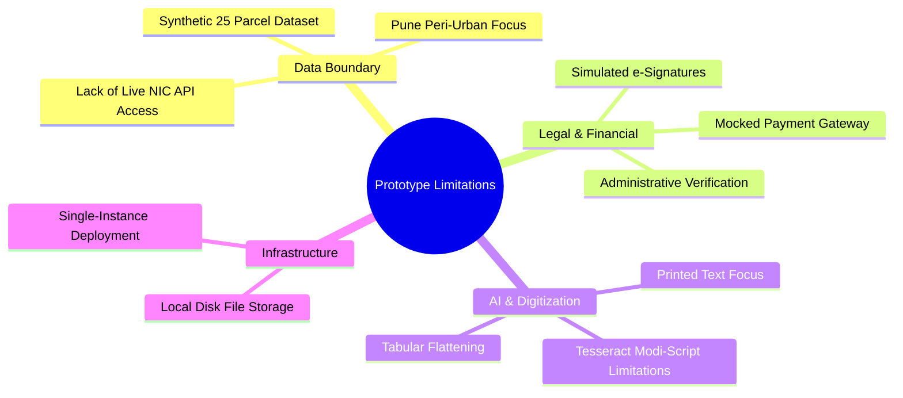

# 18. Limitations & Future Scope — Bhumisetu (भूमिसेतू)

> **Academic Year:** 2026–27  
> **Project Title:** Bhumisetu: AI-Enabled, GIS-Based Integrated Land Information & Single-Window Land Service Platform  
> **Tagline:** *"One Parcel. One Window."*  

---

## What This Document Covers

This document provides a candid, academically rigorous appraisal of the current Bhumisetu prototype's technical and operational boundaries. It transparently identifies present constraints, explains why certain enterprise features were intentionally scoped out for the academic prototype, and presents a comprehensive, phased engineering roadmap for evolving Bhumisetu into a production-grade state or national land governance platform.

---

## 1. Candid Prototype Limitations



### 1.1 Data & Live Integration Boundaries
* **Synthetic Cadastral Dataset:** The prototype is seeded with 25 realistic land parcels spanning Pune municipal and peri-urban wards (Hinjewadi, Wakad, Baner, Kothrud, Wagholi, Hadapsar). It does not encompass all 40,000+ revenue villages across Maharashtra.
* **Absence of Live NIC / Mahabhulekh API Connectivity:** State land record databases (Bhoomi in Karnataka, Mahabhulekh in Maharashtra) operate within government-restricted intranet perimeters. Access requires official government department sponsorship, bilateral memorandums of understanding (MoUs), and hardware VPN tunnels that are unavailable to academic research prototypes.

### 1.2 Legal & Financial Boundaries
* **Simulated Digital Signatures:** In the prototype, approvals are recorded through authenticated database state transitions. It lacks integration with an Indian licensed Certifying Authority (such as eMudhra or CDAC) for **Aadhaar eSign** or hardware USB crypto-tokens (DSC Class 3).
* **Mocked Municipal Payment Gateway:** Single-window applications do not process real credit card, UPI, or net-banking transactions; statutory municipal application fees are recorded with simulated clearance flags.

### 1.3 AI & OCR Extraction Boundaries
* **Printed Script Optimization:** The OCR pipeline is optimized for modern printed bilingual Marathi and English documents. Historical property records written in cursive **Modi script** (*मोडी लिपी*) or handwritten village registers produce lower recognition accuracy.
* **Complex Tabular Flattening:** 7/12 extracts contain complex nested tables (e.g., crop rotations, irrigation sources, mutation annotations). Tesseract converts these into flat character streams, requiring regex heuristic reconstruction rather than native table boundary comprehension.

### 1.4 Infrastructure & Storage Boundaries
* **Local Disk File Storage:** Uploaded deed scans are saved to a local volume (`/uploads`). Production deployment requires distributed cloud object storage (e.g., AWS S3 or MinIO) with pre-signed ephemeral URLs.

---

## 2. Production Engineering Roadmap

```mermaid
gantt
    title Bhumisetu Future Engineering Roadmap
    dateFormat YYYY-Q#
    axisFormat %Y-Q%q

    section Phase 1: Core Integrations
    Live State ULPIN / DILRMP API Bridge    :2027-Q1, 2027-Q2
    Aadhaar eSign (eMudhra) Integration     :2027-Q2, 2027-Q3

    section Phase 2: Advanced AI & Search
    pgvector & Transformer OCR (TrOCR)      :2027-Q2, 2027-Q4
    Semantic Vector Natural Language Search :2027-Q3, 2027-Q4

    section Phase 3: Field Mobility
    React Native Mobile App with GPS        :2027-Q4, 2028-Q1
    Offline Cadastral Inspection Mode       :2028-Q1, 2028-Q2

    section Phase 4: Decentralized Trust
    Hyperledger Fabric Blockchain Auditing  :2028-Q2, 2028-Q3
    Bharat Bill Payment System (BBPS)       :2028-Q3, 2028-Q4
```

---

### Phase 1: Institutional & Regulatory Integrations (Q1–Q3 2027)

#### 1. Real-Time DILRMP / Mahabhulekh Gateway
* Establish secure REST/SOAP microservice connectors conforming to the **Digital India Land Records Modernization Programme (DILRMP)** standards.
* Implement bidirectional synchronization with the state Sub-Registrar office so registered sale deeds automatically trigger spatial parcel mutations in real time.

#### 2. Legal Aadhaar eSign & DSC Integration
* Integrate ASP (Application Service Provider) gateways via eMudhra or CDAC.
* Automatically generate legally binding, tamper-evident PDF sanction certificates embedded with cryptographic X.509 digital signatures and QR verification codes.

---

### Phase 2: Advanced AI, Layout Parsing & Semantic Search (Q2–Q4 2027)

#### 1. Transformer-Based Vision-Language Document Models
* Replace Tesseract with an ensemble architecture combining **TrOCR (Transformer OCR)** and **LayoutLMv3**.
* Fine-tune vision-language models on the *IndicLandRecords* dataset to extract handwritten Devanagari script and complex tabular boundaries with greater than 96% accuracy.

#### 2. Dense Vector Embeddings & Semantic Search
* Convert full-text document transcripts into 1536-dimensional vector embeddings using models like BGE-M3 or `text-embedding-3-small`.
* Deploy PostgreSQL **`pgvector`** with HNSW (Hierarchical Navigable Small World) spatial-vector indexes.
* Enable conversational, natural-language cadastral queries:
  > *"Find all commercial plots along Hinjewadi Phase 1 with approved building sanctions issued after January 2024."*

---

### Phase 3: Field Mobility & Drone Photogrammetry (Q4 2027 – Q2 2028)

#### 1. Mobile Field Application for Talathis & Surveyors
* Develop a cross-platform mobile client (React Native / Flutter) designed for field revenue officers.
* Incorporate real-time GPS RTK (Real-Time Kinematic) geofencing: when a surveyor stands on-site, the mobile app automatically highlights the active parcel polygon and prompts for photographic inspection evidence.

#### 2. Drone Survey & LiDAR Cadastral Overlay
* Enable direct ingestion of orthorectified drone survey imagery (GeoTIFF) and LiDAR point clouds.
* Superimpose live physical drone imagery over historical revenue cadastral boundaries to immediately detect physical land encroachments.

---

### Phase 4: Decentralized Audit & Financial Rail Integration (Q2–Q4 2028)

#### 1. Permissioned Blockchain Auditing (Hyperledger Fabric)
* While relational databases provide operational efficiency, government title registries require mathematical non-repudiation.
* Anchor every approved application, mutation record, and officer sanction to a private, permissioned **Hyperledger Fabric** blockchain consortium operated jointly by the Revenue Department, Municipal Corporation, and the High Court Registry.

#### 2. Bharat Bill Payment System (BBPS) & UPI 2.0 Integration
* Integrate the National Payments Corporation of India (NPCI) Bharat Bill Payment System (BBPS) and UPI AutoPay rails.
* Allow citizens to pay municipal development charges, non-agricultural cess, and property scrutiny fees with automated instant receipt generation.

#### 3. Complete Multilingual Localization (i18n)
* Expand frontend single-window wizards with full localization into **Marathi (मराठी)** and **Hindi (हिन्दी)** using `i18next`, ensuring universal accessibility across rural farming communities.

---

## Key Takeaways

1. **Transparent Prototype Boundaries:** Clearly identifies current constraints regarding synthetic parcel datasets, local disk storage, and offline demonstration OCR.
2. **Justified Academic Scoping:** Explains why live NIC government APIs and legal eMudhra e-signatures were separated as future enterprise milestones.
3. **Phased Engineering Roadmap:** Details a practical four-phase expansion plan spanning live state revenue bridges, transformer AI, mobile field tools, and blockchain audit.
4. **Cutting-Edge Technical Vision:** Formulates concrete architectures for `pgvector` semantic search, drone GeoTIFF overlays, and Hyperledger Fabric integration.
5. **High Academic Value:** Demonstrates that the authors understand both the engineering reality of the prototype and the institutional complexity of nationwide land digitization.
