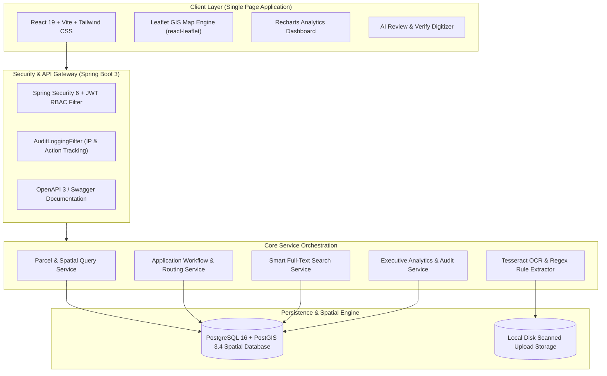
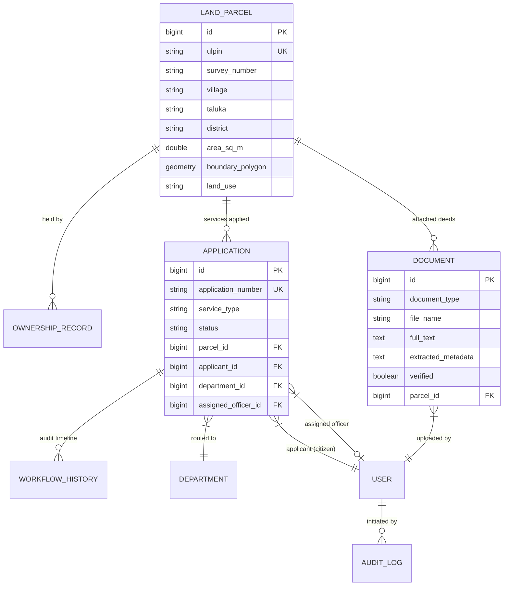
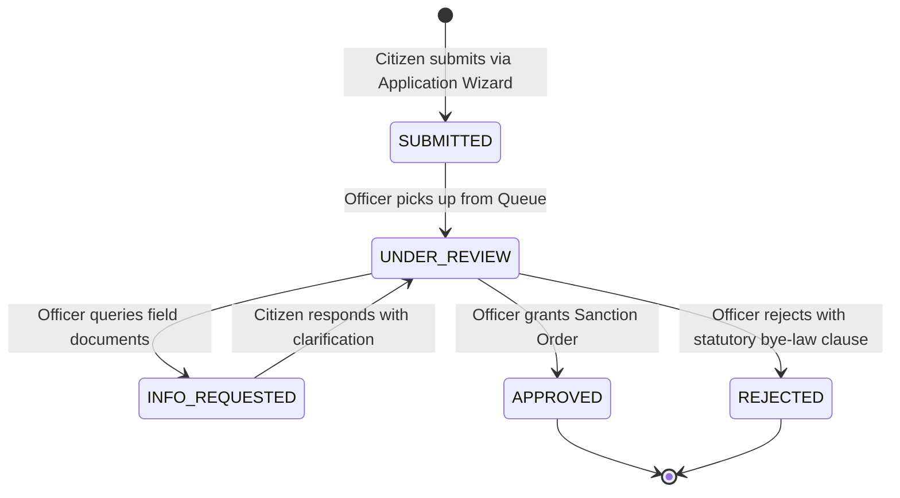
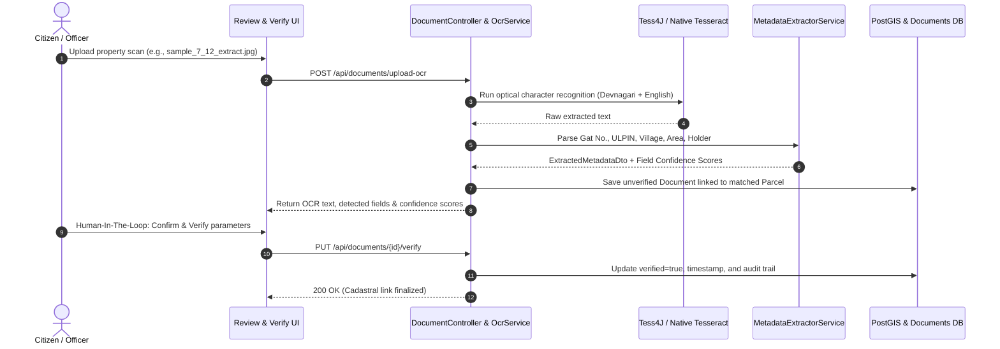

# Bhumisetu (भूमिसेतु) — Architecture & Technical Design

Bhumisetu is an AI-enabled, GIS-based integrated land information and single-window service platform. It replaces fragmented municipal and revenue clearance processes with a **parcel-centric** paradigm where all land rights, spatial geometry, scanned deeds, and department applications attach directly to a verified cadastral unit.

---

## 1. System Architecture Overview

---

## 2. Parcel-Centric Data Model

In Bhumisetu, a **LandParcel** (with its PostGIS geometry and 14-character ULPIN) is the root aggregate:

---

## 3. Single-Window Workflow State Machine & RBAC

Bhumisetu enforces strict Separation of Concerns. Citizens can submit applications but are mathematically blocked from approving them. Only departmental officers and administrators can record review decisions.

### Department Routing Rules:
| Service | Routing Department | Competent Officer | Standard SLAs |
| :--- | :--- | :--- | :--- |
| **Building Permission** | Town Planning & Municipal Sanctions (`PLANNING`) | `PLANNING_OFFICER` | 7 Days |
| **Land-Use Change** | Revenue & Land Records / Collectorate (`REVENUE`) | `REVENUE_OFFICER` (Tahsildar) | 15 Days |
| **Water Connection** | Water Supply & Public Utilities (`UTILITY`) | `UTILITY_OFFICER` | 3 Days |

---

## 4. AI OCR & Metadata Extraction Pipeline

Scanned land documents (such as 7/12 Satbara Extracts) undergo a hybrid digitization process:

---

## 5. Security Architecture (RBAC & Audit Trail)

1. **Stateless JWT Authentication**: Tokens issued using HMAC-SHA256 with user roles and email claims.
2. **Role Hierarchy**:
   - `CITIZEN`: Search parcels, view dossiers, upload documents, submit applications, track status.
   - `PLANNING_OFFICER`: Review Town Planning queue, approve/reject building permissions.
   - `REVENUE_OFFICER`: Review Revenue queue, approve/reject land-use NA conversions.
   - `UTILITY_OFFICER`: Review Water Supply queue, approve/reject pipeline sanctions.
   - `TREE_OFFICER`: Environmental oversight and felling NOCs.
   - `ADMIN`: Global analytics, cross-department queue management, user directory, security audit log access.
3. **Immutable Audit Logs**: Automatically recorded on every security event, document upload, and workflow state transition with IP address, user identity, and target entity IDs.
